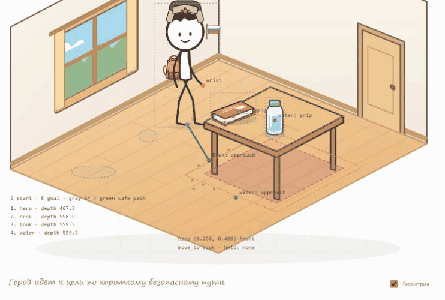

# Уровень 2 «Мой дом» — прототип 1

Из первого уровня нажмите «В мир». Появится пустая комната: две стены, дощатый пол, окно, дверь и ваш герой. «К герою» возвращает анкету. «Очистить комнату» удаляет только три предмета, сохраняя характеристики героя.

Локально: `npm run dev`, адрес http://localhost:5173. Для прямого входа в комнату: http://localhost:5173/?level=2. После обновления файлов нажмите Ctrl+F5. В подвале видна метка «Уровень 2 · Мой дом · Прототип 1».

## Команды

| Фраза | Результат |
|---|---|
| 책상이 있어요. | Создать стол |
| 책이 있어요. | Создать книгу |
| 물이 있어요. | Создать воду |
| 책하고 물이 있어요. | Последовательно создать книгу и воду |
| 책상이 없어요. | Убрать стол |
| 책이 없어요. | Убрать книгу |
| 물이 없어요. | Убрать воду |
| 책을 읽어요. | Подойти, взять книгу, открыть и прочитать, вернуть |
| 물을 마셔요. | Подойти, взять бутылку, поднести ко рту, вернуть |

Принимаются однозначные варианты без частиц: `책 있어요`, `물 마셔요`. Для тестирования есть прежний текстовый ввод. Голос использует тот же MediaRecorder и серверный Groq Whisper: начало первым нажатием, отправка полной записи вторым, сохранение пауз, отмена. Обработка первого уровня не менялась. Вопросы, неоднозначные и неизвестные команды комнаты не применяются.

## Правила размещения

Всего по одному экземпляру каждого предмета. Книга и вода создаются на столе, если он уже есть, иначе — в отдельных фиксированных местах пола. Появление стола не поднимает ранее созданные предметы. При удалении стола только лежащие на нём вещи переходят в свои свободные места на полу. Команды исполняются последовательно, очередь ограничена шестью ожидающими фразами. При выходе незавершённая команда отменяется без применения результата.

Предмет возвращается точно на прежнюю поверхность. При отсутствии вещи герой показывает вопрос и предлагает сначала создать её. Повторное создание сообщает, что предмет уже существует.

Состояние комнаты хранится отдельно под ключом `korean-stickman.room.v1`; сохранение героя `korean-stickman.hero.v2` остаётся прежним. При перезагрузке предметы восстанавливаются, персонаж начинает с исходной точки. Если localStorage запрещён, комната работает до закрытия вкладки.

## Геометрия и отладка

Комната — обычный SVG с ортографической проекцией координат пола. `src/room-state.js` содержит зону/высоту/масштаб стола, поверхность, места предметов, точки подхода и хвата. Общая функция проекции используется для рисунков и взаимодействий. Настоящей физики и универсального поиска пути нет.

Персонаж обходит стол по фиксированному свободному коридору перед ним; при хвате с пола приседает. Используется существующий скелет, лицо и аксессуары героя из первого уровня. Предмет прикрепляется к фактическому положению кисти; бутылка при наклоне достигает рта. Отрисовка сортируется по глубине пола; вещи на столешнице следуют после стола, герой перед столом перекрывает его.

Переключатель «Геометрия» показывает занимаемую мебелью область, столешницу, места на полу, точки подхода/хвата, кисть, границы и порядок глубины. В обычном режиме эти отметки скрыты. Остальные рисунки — подготовленные SVG в `src/room-art.js`; внешних изображений и дополнительных библиотек нет.

## Проверки

- `npm test`: 59/59. Новые проверки покрывают все команды ТЗ, неразрешённые формулировки, повторное создание, поверхности, удаление стола, независимое сохранение, сериализацию и отмену действий.
- Проверены все пары фиксированных маршрутов с запасом вокруг мебели. Рука достигает всех четырёх хватов (два предмета × две поверхности), длины плеча и предплечья сохраняются; промежуточные позы подъёма тоже достижимы. Проверена близость горлышка к рту при питье.
- В браузере проверены пустая/заполненная комнаты, последовательное создание, книга до стола, удаление стола, чтение и питьё с обеих поверхностей, отсутствующая книга, геометрия, возврат к герою и повторный вход. Ошибок в консоли этого прогона нет.
- Отдельно проверяется статическая сборка для `/korean-stickman/`. Схема GitHub Pages + Render и настройки CORS остаются прежними. Сервер, ключи и аудиомодуль в этом обновлении не изменялись.

Браузерная демонстрация записана с ручными фразами. Новый живой микрофонный прогон через Groq не выполнялся; прежние тесты ручного завершения, пауз, отмены и ошибок продолжают проходить. Публикация не выполнялась.

## Материалы

[Пустая комната](home-empty.png) · [Заполненная комната](home-filled.png) · [Отладка](home-debug.png)

