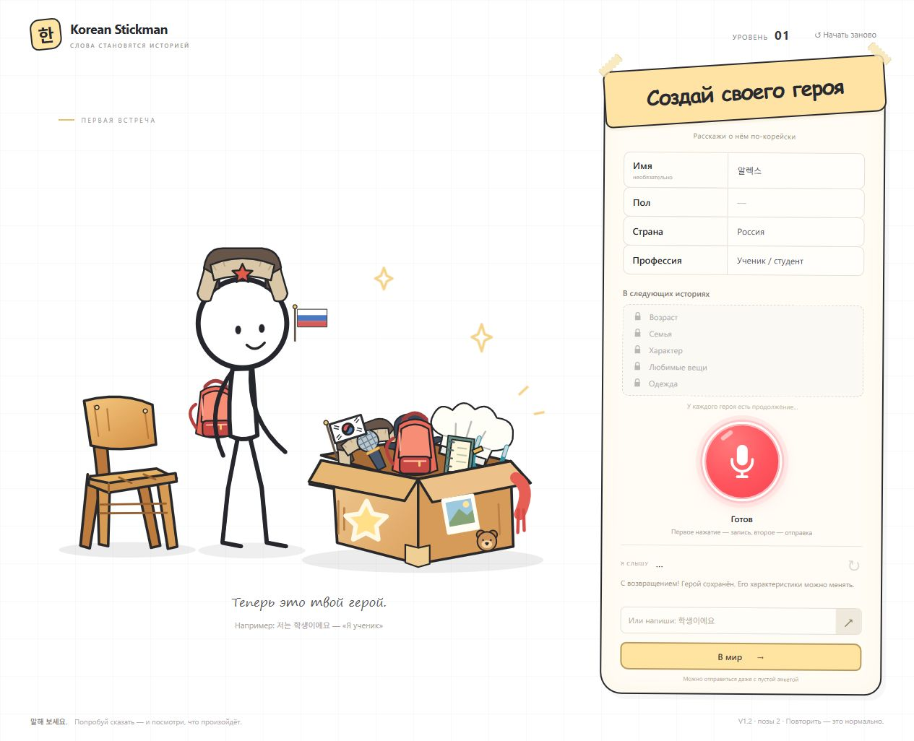

# Проверка разделения frontend и API

Дата: 1 ноября 2026.

- `npm ci`: без дополнительных зависимостей.
- `npm test`: 52/52. В том числе OPTIONS/CORS с Host `korean-stickman.onrender.com` и Origin `https://averanges.github.io`, отказ другому источнику, читаемые API-ошибки, отсутствие секретов в сборке, сетевой сбой/503, тайм-аут чтения ответа и отмена.
- `npm run build:pages` с API_BASE_URL `https://korean-stickman.onrender.com`: успешно. Публичный адрес в сборке, сервер и .env отсутствуют.
- Отдельный статический сервер без API, адрес `http://localhost:5174/korean-stickman/`: интерфейс, встроенные рисунки и анимация смены страны работают; `저는 러시아 사람이에요.` применяет Россию. Перезагрузка сохраняет характеристики. Основная вкладка localhost:5173 не сбрасывалась.
- Изолированный запуск серверной команды в режиме Render: `/` и `/src/main.js` дают 404, `/api/stt/status` — 200; `.env` недоступен. Локальный режим: интерфейс и JS дают 200, `.env` — 404. Реальные запросы в Groq в этом прогоне не отправлялись.
- Модули записи, интерпретации, профиля, очереди, геометрии и рисунков не изменены. Прежние тесты ручного завершения и четырёхсекундной паузы проходят.

Публичные GitHub Pages и Render в рамках задачи не обновлялись. Эти проверки не заменяют заключительную проверку реального HTTPS/CORS/микрофона после вашей публикации; порядок приведён в [RENDER.md](RENDER.md).

