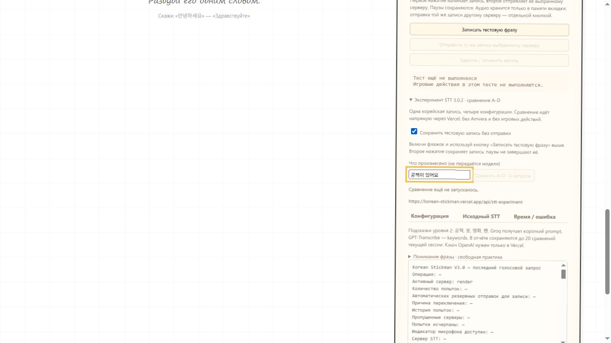

# STT 3.0.2 — эксперимент Groq Whisper / GPT-Transcribe

Подготовлены четыре конфигурации для одной и той же записи. Основная игра продолжает использовать прежний Groq Whisper без контекста. Новый провайдер не включён в автоматический выбор или failover. Публикация не выполнялась.

**Главное ограничение результата:** OpenAI пока не проверен реальными запросами: по вашему решению ключ будет добавлен только в Vercel после обновления. Записей четырёх целевых команд учеников также пока нет. Объявлять победителя по точности сейчас нельзя.

## Конфигурации

| Код | Провайдер / модель | Контекст |
|---|---|---|
| A | Groq, `STT_MODEL` — по умолчанию `whisper-large-v3` | Без prompt |
| B | Та же модель Groq | Короткий корейский prompt уровня 2 |
| C | OpenAI `gpt-transcribe` | `languages: ["ko"]`, без keywords и prompt |
| D | OpenAI `gpt-transcribe` | `languages: ["ko"]`, keywords `공책`, `옷`, `영화`, `펜` |

Для Groq обе конфигурации передают `language:"ko"`. Стандартный prompt B:

```text
공책, 옷, 영화, 펜. 공책이 있어요. 옷을 사요. 영화를 봐요. 펜이 있어요.
```

В нём 97 байт UTF-8. Сервер ограничивает пользовательский экспериментальный `GROQ_STT_PROMPT` 224 байтами UTF-8 — это консервативная верхняя граница, укладывающаяся в ограничение Whisper 224 токена. Это не утверждение, что prompt содержит ровно 97 токенов. [Groq: параметры и ограничения prompting](https://console.groq.com/docs/speech-to-text).

Имя модели OpenAI сохранено точно: `gpt-transcribe`. Используется `https://api.openai.com/v1/audio/transcriptions`. Массивы передаются в multipart как `languages[]=ko` и отдельные `keywords[]=...`. Устаревшее `language` для OpenAI не отправляется. Для D дополнительный prompt не потребовался: различие с C ограничено keywords. Это соответствует [официальному руководству OpenAI](https://developers.openai.com/api/docs/guides/speech-to-text). Подсказки не гарантируют правильное распознавание и не должны превращаться в обязательные слова ответа.

## Архитектура эксперимента

```text
Ручная запись → аудио в памяти вкладки → явная кнопка «Сравнить A–D»
                                     → Vercel /api/stt-experiment, A
                                     → тот же endpoint, B
                                     → тот же endpoint, C
                                     → тот же endpoint, D
                                     → таблица исходных транскрипций и отчёт
```

Каждый запрос содержит один полный исходный файл. Запросы идут последовательно, без автоматических повторов. Во все четыре передаётся тот же Blob; SHA-256 файла проверяется по ответам сервера. В отчёте есть контрольная сумма, MIME, размер, длительность, выбранная модель, конфигурация, исходный текст, время, HTTP-код и ошибка провайдера.

Текст не пропускается через языковой слой, LLM-корректор или игровой движок. Пробелы и пунктуация ответа провайдера сохраняются. Для Groq отдельно показано, счёл бы существующий фильтр запись неразборчивой: эксперимент сохраняет исходный текст даже в таком случае. Для OpenAI аналогичные метрики Whisper не выдумываются.

Тайм-аут сервера — 40 секунд на конфигурацию, клиентский — 55 секунд. Четыре последовательных запроса могут занять до примерно 220 секунд при проблемах сети; есть отмена. На сервере отдельные лимиты: 1 одновременный запрос, 8 обращений в минуту на экземпляр, аудио до 4 000 000 байт и 5 минут. Это два полных сравнения в минуту; третий запуск подряд может получить 429. Лимиты serverless действуют на экземпляр, а не являются глобальным лимитом расходов аккаунта.

Только четыре заранее заданных варианта; произвольный URL, модель или prompt из браузера не принимаются. Прежние проверки Host/Origin, `X-Requested-With` и MIME сохраняются. Новый CORS-заголовок `X-STT-Experiment` разрешён только на новом маршруте. В Vercel используется нативный файл функции `api/stt-experiment.js`; изменения `vercel.json` не нужны.

## Как обновить Vercel и Pages

1. Обновите репозиторий подготовленной версией 3.0.2, включая новые `api/stt-experiment.js`, `server/openai-stt.mjs`, `server/stt-experiment.mjs` и клиентские модули `src/stt-experiment*.js`. Не добавляйте `.env` или ключи в Git.
2. В Vercel откройте проект → **Settings → Environment Variables**. Добавьте секрет **OPENAI_API_KEY** для **Production**. В Preview добавляйте только если собираетесь тестировать соответствующий deployment.
3. Существующий `GROQ_API_KEY`, `FRONTEND_ORIGIN=https://averanges.github.io` и рабочие настройки адресов оставьте прежними.
4. По желанию добавьте **GROQ_STT_PROMPT** — короткий корейский контекст. Если переменной нет, используется приведённый prompt. Он применяется только к B, а не к обычным занятиям. Неподходящий/слишком длинный prompt отклоняется, не обрезается незаметно.
5. После сохранения переменных выполните **Redeploy** Vercel на новой версии. Старый deployment новых переменных не увидит. Для C/D нужен доступ аккаунта к запрошенной модели и достаточная квота API; ошибки авторизации, модели и квоты показываются отдельно от текста.
6. После Vercel запустите существующий workflow GitHub **Publish frontend to GitHub Pages → Run workflow**. Новых переменных или секретов GitHub Actions не требуется.
7. Откройте `https://averanges.github.io/korean-stickman/` и выполните **Ctrl+F5**, чтобы не смешать новый HTML со старыми JavaScript-файлами.

**OPENAI_API_KEY не добавлять в GitHub Pages, Amvera, Render или Netlify.** Для этого эксперимента он нужен только Vercel. Основные маршруты `/transcribe`, `/api/stt` не меняют контракт. Amvera продолжает пересылать свой `/transcribe` до Vercel; через неё новый эксперимент не идёт. Render и Netlify обновлять для запуска эксперимента не требуется. В локальном Node-сервере тот же экспериментальный маршрут доступен для разработческих проверок, но интерфейс сравнения намеренно направлен на Vercel.

Если Vercel ещё не обновлён, таблица покажет, что эксперимент не развёрнут. Если ключ OpenAI не задан, A/B могут завершиться успешно, а C/D покажут «В Vercel не настроен ключ OpenAI». Ключ не требуется вводить в браузере.

## Как записать один раз и сравнить

1. Откройте «Настройки голоса / тестирование» → **«Эксперимент STT 3.0.2 · сравнение A–D»**.
2. Включите **«Сохранить тестовую запись без отправки»**. Этот флажок выключен по умолчанию, поэтому прежний отдельный тест STT сохраняет своё поведение.
3. Кнопкой **«Записать тестовую фразу»** выше начните запись. Произнесите фразу и нажмите **«Завершить и сохранить запись»**. Длинные паузы запись не завершают.
4. В поле **«Что произнесено»** запишите фактически произнесённый текст. Этот эталон остаётся локально и **не передаётся модели**, чтобы не подсказывать правильный ответ.
5. Нажмите **«Сравнить A–D · 4 запроса»**. До этого шага аудио в режиме сохранения не отправлялось. Результаты не выполняются как игровые команды.
6. Сравните исходные строки, длительности и ошибки. Если модель вставила словарное слово, отсутствующее в эталоне, появится отметка для ручной проверки. Это простое текстовое наблюдение, не грамматическая оценка.
7. Для следующей фразы снова используйте кнопку записи. До 20 сравнений текущей сессии сохраняются в общем отчёте, даже когда записывается новая фраза. По желанию можно явно снова сравнить тот же сохранённый файл: это ещё четыре запроса, а не автоматический повтор.
8. Нажмите **«Скопировать отчёт»**. Он содержит транскрипции и локальный эталон; просмотрите их перед передачей другим людям. Ключи распространённых форматов скрываются.
9. **«Удалить / отменить запись»** удаляет текущий файл и историю эксперимента из памяти. Перезагрузка тоже очищает их. Отдельная кнопка отмены сравнения прекращает дальнейшие запросы и сохраняет уже завершённые результаты.

Аудиофайлы на сервере не сохраняются, содержимое записей и ключи в логи не выводятся. Полная история не отправляется провайдерам. Для ученических записей нужно согласие участников на передачу Groq и OpenAI.



## План сравнения на целевых записях

Машиночитаемый список: [stt302-protocol.json](stt302-protocol.json). Он содержит **план**, а не аудиофайлы и не выдуманные результаты.

| Группа | Фразы |
|---|---|
| Целевые | `공책이 있어요`, `옷을 사요`, `영화를 봐요`, `펜이 있어요` |
| Контрольные | `안녕하세요`, `책이 있어요`, `물을 마셔요`, `의자에 앉아요` |
| Отрицания | `공책이 없어요`, `옷을 사지 마세요`, `영화를 안 봐요`, `펜이 아니에요` |
| Близкие и неизвестные слова | `꽃이 있어요`, `병이 있어요`, `공이 있어요`, `냉장고 있어요` |

Рекомендуемый первый набор: два участника, по две независимые записи целевых фраз и по одной записи остальных. Это 40 записей и 160 API-запросов при полном A–D. Можно начать с одного прохода 16 фраз, но это ещё слабая основа для смены основного STT.

Для каждого файла сохраняйте одинаковый эталон и четыре результата. Проверяйте: целевое слово, сохранность отрицания, добавление непроизнесённых слов и время. Число ошибок API учитывайте отдельно от ошибок распознавания. Для буквального совпадения отдельно оговорите, игнорируете ли пунктуацию и начальные пробелы; исходные строки всё равно сохраняйте.

Повторите часть записей с привычными для урока микрофоном, паузами и шумом. Фиксированный порядок A–D и сеть могут влиять на задержки, поэтому не оценивайте скорость по одному запуску. Полезно смотреть медиану и разброс на нескольких файлах, а не только самое быстрое измерение.

## Уже полученные реальные результаты

Использованы три ранее применявшиеся открыто лицензированные человеческие записи. Это контрольные короткие записи, **не четыре целевые команды учеников**. Для каждой A и B получили идентичные аудиобайты, что подтверждено одинаковыми SHA-256. Выполнено 6 реальных запросов Groq. Реальных OpenAI-запросов — 0.

| Произнесено по источнику | A: исходный Whisper | B: исходный Whisper с контекстом | A / B, полный запрос |
|---|---|---|---|
| `안녕하세요` | ` 안녕하세요` | ` 안녕하세요.` | 404 / 340 мс |
| `물을 마시다` | ` 물을 마시다` | ` 물을 마시다.` | 336 / 371 мс |
| `침대` | ` 침대` | ` 침대` | 344 / 338 мс |

Начальные пробелы и точные строки доступны в [stt302-control-results.json](stt302-control-results.json). На этих трёх файлах слова совпали в A и B; в двух случаях B добавил точку. Словарные слова, которых не было в записи, на этих примерах не появились. Этого недостаточно, чтобы подтвердить безопасность контекста или улучшение на `공책`, `옷`, `영화`, `펜`.

Источники записей: [안녕하세요 — HappyMidnight, CC BY-SA 4.0](https://commons.wikimedia.org/wiki/File:안녕하세요.ogg), [물을 마시다 — HappyMidnight, CC BY-SA 4.0](https://commons.wikimedia.org/wiki/File:물을_마시다.ogg), [침대 — CHK2605, CC0](https://commons.wikimedia.org/wiki/File:LL-Q9176_(kor)-CHK2605-침대.wav). Аудиофайлы в архив не включены.

| Сравнение | Что можно заключить сейчас |
|---|---|
| A против B на трёх контрольных файлах | Разницы в распознанных словах не видно |
| A/B на четырёх целевых командах | Записи и результаты ещё не собраны |
| C против D, Groq против OpenAI | Реальных результатов пока нет, нужен ключ и запуск в Vercel |
| Отрицательные и близкие слова из протокола | План готов; качество на реальном аудио ещё не измерено |

## Рекомендация для обычных занятий

**Пока оставить Groq Whisper без контекста.** Это сохранение рабочего режима на время эксперимента, а не доказанный вывод, что он точнее GPT-Transcribe. Контекст B и модель C/D доступны только для явного диагностического сравнения.

Менять основной STT стоит после накопления результатов: несколько записей каждого проблемного слова, контрольные команды, сохранность отрицаний и отсутствие заметного роста непроизнесённых слов. Победу по одному удачному примеру или общему рекламному описанию модели объявлять нельзя.

## Технические проверки

312 автоматических тестов прошли: прежняя регрессия и 15 новых тестов эксперимента. Проверены корректные multipart-параметры OpenAI, отсутствие `language` вместе с `languages`, prompt только у B, keywords только у D, сырые ответы, отсутствие корректора, сохранение одинакового файла, SHA-256, последовательность, отмена, поздние ответы, тайм-ауты, CORS, отдельные лимиты, отсутствие ключа, реальная точка входа Vercel и совместимость старых маршрутов.

В браузере проверены открытие раздела, флажок сохранения, локальный эталон и блокировка сравнения до появления аудио. Голос с микрофона пользователя при этой проверке не записывался.

Команда тестов:

```sh
node --test --test-concurrency=2 tests/*.test.js
```

Основные добавленные файлы: `server/openai-stt.mjs`, `server/stt-experiment.mjs`, `api/stt-experiment.js`, `src/stt-experiment.js`, `src/stt-experiment-config.js` и тесты. Прежний `GroqWhisper` получил необязательные параметры экспериментального raw-ответа и prompt; их значения по умолчанию сохраняют старое поведение. Ни один файл языкового интерпретатора, комнаты, навигации или анимаций не изменялся.
