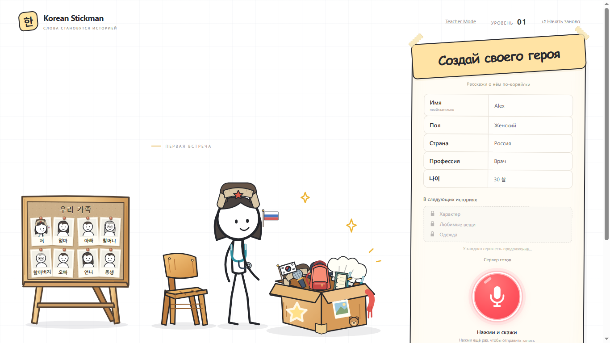
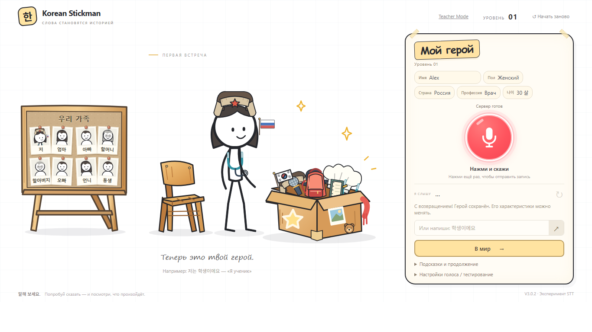
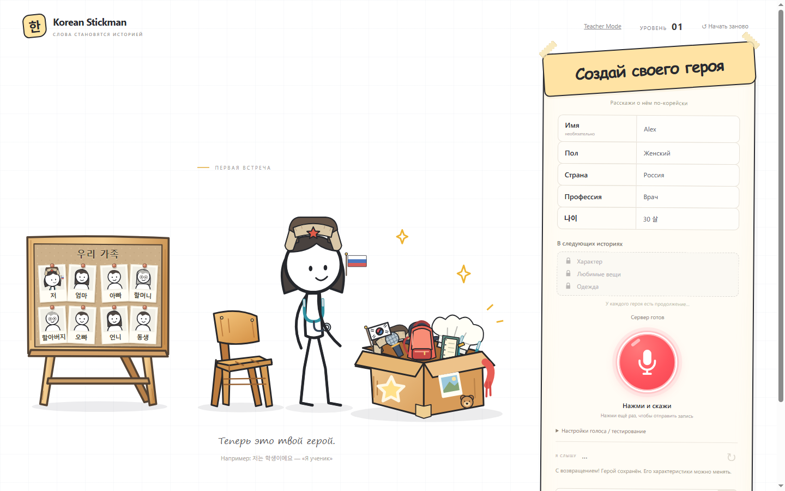
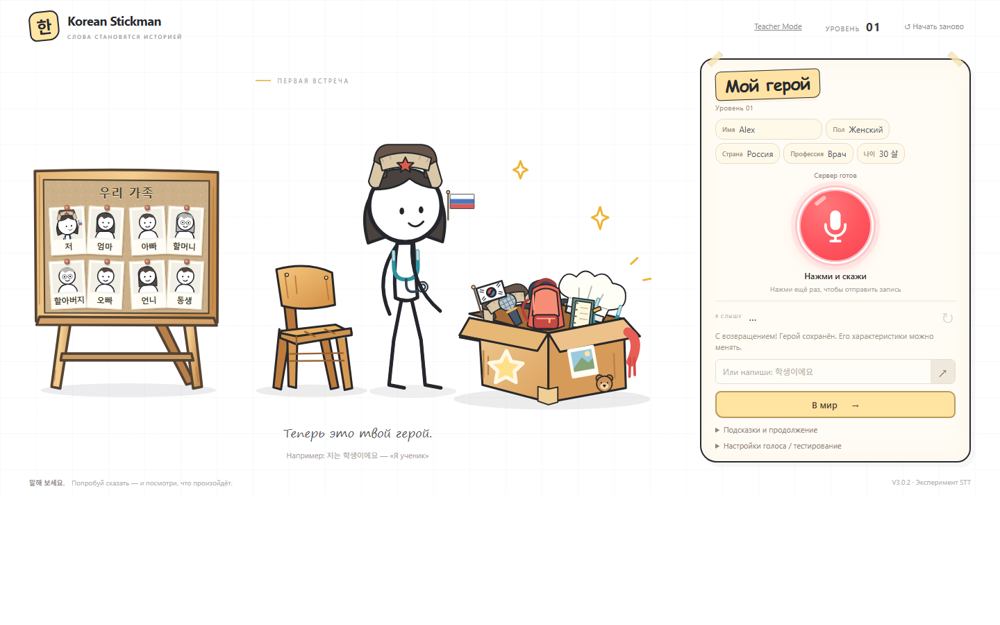
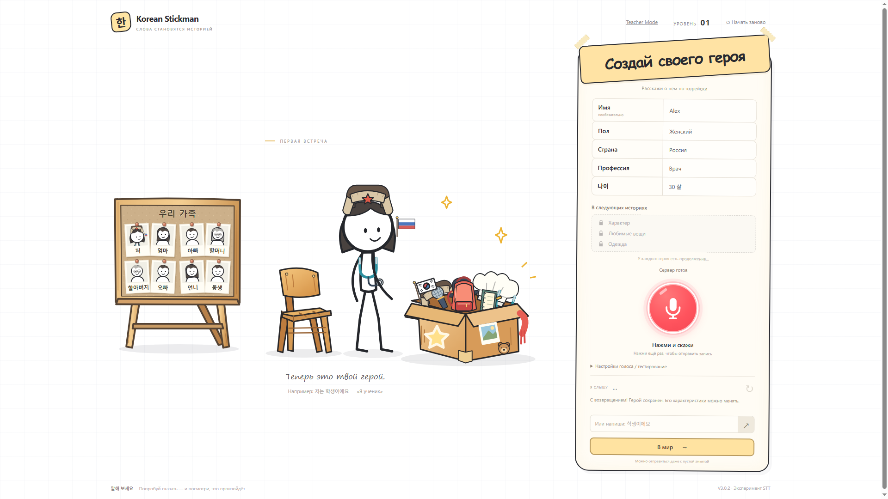
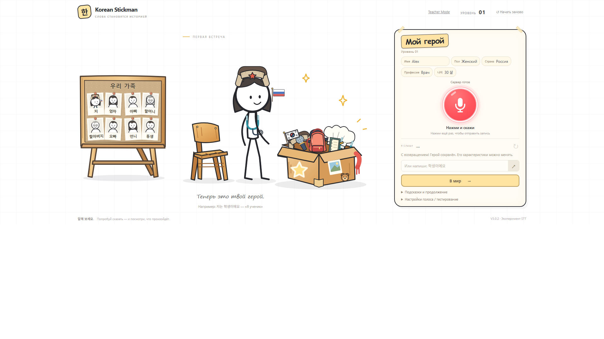

# Level 1 — компактная панель

Изменены только компоновка первого уровня и её адаптивные стили. Публикация не выполнялась.

## Результат

- Вместо пяти высоких строк — плашки с переносом: имя, пол, страна, профессия, возраст. Прежние элементы и ID сохранены; данные обновляются тем же кодом после игровых и учительских действий.
- Заголовок «Мой герой» и короткая отметка уровня вместо крупной вывески.
- Микрофон 110×110 px остаётся основным элементом. Запись, стоп, обработка, шкала громкости, отмена и техническая ошибка сохранены.
- Последняя фраза, индикатор результата, пояснение и однострочное поле ввода идут подряд. Большая минимальная высота результата убрана; длинные ошибки раскрываются естественно.
- «В мир» находится до второстепенных разделов.
- Будущие возможности и инструкции доступны в закрытом разделе «Подсказки и продолжение». Голосовые настройки и диагностика также закрыты изначально, содержимое сохранено. Их открытие не требует перезагрузки.
- Развёрнутая диагностика имеет собственную прокрутку; микрофон и отмена не помещены внутрь неё.
- Сообщение о подключении к преподавателю занимает компактную строку с переносом при необходимости. Настоящие ошибки соединения не скрываются.

Глобальные scale/zoom, фиксированная высота основной панели и обрезание сообщений не использовались. В сцене, SVG-персонаже, семейном стенде, возрастных изменениях, сохранениях, интерпретаторе и серверах STT изменений нет. Редактировались `index.html`, `src/style.css` и только UI-строки/переключение стилей в `src/main.js`. Основная панель преподавателя не менялась.

## Размеры при 100%

Снимки сделаны в одной версии изолированного Chrome, с одинаковым сохранением тестового героя и тем же окном. Device scale factor и visualViewport.scale — 1. Уменьшение страницы не применялось. Для неподвижных сопоставимых кадров в обоих вариантах включён режим уменьшенной анимации.

| Окно | Высота панели до | После | Высота страницы до → после |
|---|---:|---:|---:|
| 1366×768 | 910 px | 581 px | 1081 → 768 px |
| 1440×900 | 910 px | 581 px | 1081 → 900 px |
| 1920×1080 | 914 px | 565 px | 1084 → 1080 px |

На всех трёх настольных размерах после изменений нет вертикальной прокрутки в исходном свёрнутом состоянии; микрофон и «В мир» находятся в окне. На 1366×768 это также проверено при активном подключении к тестовому уроку. Длинные сообщения и раскрытие второстепенных разделов могут увеличивать страницу — содержимое не отрезается.

### 1366×768

| До | После |
|---|---|
|  |  |

### 1440×900

| До | После |
|---|---|
|  |  |

### 1920×1080

| До | После |
|---|---|
|  |  |

## Дополнительные проверки

- На 390×900 горизонтального переполнения нет; вертикальная прокрутка разрешена и нужна для прежней большой сцены. Высота страницы сократилась с 1864 до 1523 px, панель — примерно с 890 до 589 px. Микрофон 110 px.
- Проверены состояния записи с видимым стопом, работающая шкала громкости и доступная отмена; затем обработка и отмена отправки.
- При раскрытии настроек доступна внутренняя прокрутка, микрофон и переход остаются выше неё.
- Проверена длинная ошибка: текст и карточка не обрезаются.
- В двух изолированных контекстах браузера создан реальный тестовый урок через отдельный HTTP-сервис комнат. Ученик подключился; команда возраста от преподавателя обновила плашку до 10 살 с подтверждением движка, команда семьи убрала нужную карточку. Пользовательские уроки и сервер на 8081 не затрагивались.
- При переходе на второй уровень геометрия и вычисленные стили его панели совпали с исходными — и с закрытой, и с открытой диагностикой. Пояснение о сохранении характеристик возвращается на прежнее место.
- Все 359 автоматических тестов прошли. Сборки Pages и backend завершились успешно.

Браузер использовал тестовые аудио/ответы STT. Реальный микрофон, внешние провайдеры и сеть ученика в этой проверке не тестировались, их реализация не менялась.

## Как открыть

В текущей локальной игре и панели достаточно **Ctrl+F5**. Новый урок и перезапуск сервиса комнат не нужны, если уже используется актуальный сервис. Для публикации обновляется GitHub Pages обычным workflow, новых переменных окружения нет.
