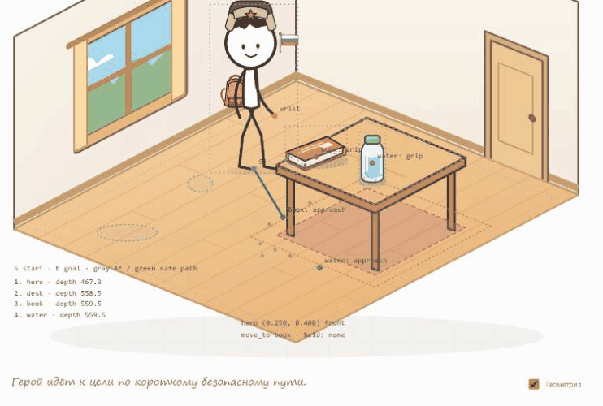

# V2.2 — навигация и общие взаимодействия

Это отчёт предыдущей итерации. Текущие маршруты и ракурсы описаны в [V2.3](V2.3.md); общий файл демонстрации обновляется вместе с игрой.

Переработан существующий второй уровень. Первый уровень, ракурс комнаты, каталог характеристик, сервер и запись речи сохранены. Публикация не выполнялась.

## Что изменилось

| Область | Результат |
|---|---|
| Координаты | Логические координаты пола отделены от SVG-проекции; масштаб героя зависит от глубины |
| Навигация | A* с обходом занятых областей, запасом вокруг мебели и упрощением маршрута по видимости |
| Позиция героя | Следующая команда начинается с фактической позиции; она сохраняется при переходе между уровнями и перезагрузке |
| Походка | Фаза шагов зависит от пройденного расстояния; ноги чередуются, опорная стопа остаётся в мировых координатах, колени рассчитываются с фиксированной длиной костей |
| Направление | Профиль с отражением, упрощённые фронтальный и задний ракурсы; плавные смены направления и переступание при остановке |
| Местоположение предмета | Одно поле location: пол, стол, рука или отсутствие; тип, поверхность, координаты, действия, хват и состояние находятся в общей модели |
| Взятие | Поиск точки подхода → движение → поворот → достижение хвата → передача владения в момент контакта → удержание |
| Использование | Книга и бутылка используют общие take/put, но имеют отдельные анимации чтения и питья |
| Книга | Плавное раскрытие/закрытие относительно фиксированного хвата; согласованные размеры без мгновенной замены изображения |
| Бутылка | Подъём, наклон к губам, несколько глотков, опускание |
| Появление | Конечная опора выбирается заранее; вертикальное падение сохраняет X, после фиксации нет дополнительного сдвига |
| Очередь | waiting → running → completed/error; идентификатор операции сохраняется между её состояниями; до шести ожидающих фраз |
| Ошибки | Проверяются наличие предмета, занятая рука, доступность маршрута и досягаемость хвата. Ошибка не сбрасывает героя на старт |

### Автоматический режим

Корейские команды остались прежними. `책을 읽어요` и `물을 마셔요` собираются из операций move_to, take, use и put. При необходимости отдельная move_to возвращает героя к исходной поверхности перед put. Если предмет уже в руке, повторное взятие пропускается. Это одна система состояния и анимаций с пошаговым режимом.

Создание/удаление и `책하고 물이 있어요` сохранены. Книга до стола остаётся на полу. Удаление стола переносит только лежащие на нём вещи; у предмета в руке меняется адрес возврата на пол. Удалить предмет прямо из руки нельзя: сначала put.

### Пошаговая проверка

Включите «Геометрия» и используйте прежнее поле текстовой фразы:

1. `/move_to book` — подойти, ничего не брать.
2. `/take book` — взять, ничего не читать.
3. `/use book` — прочитать, оставить в руке.
4. `/put book` — вернуть на исходную поверхность.

Вместо book можно использовать water; `/move_to desk` подходит к столу со стороны книги. Если книга находится на полу, подходить нужно к книге, а не к столу. После ухода с предметом в руке для put необходимо вернуться в зону исходной опоры. Автоматическая корейская команда делает этот возврат сама.

Слэш-команды работают только при включённой отладке и только через ручной ввод. Новая учебная грамматика и голосовые пошаговые задания не добавлены.

Операции open и close включены в интерфейс, но текущие объекты не объявляют их поддержку. `/open desk` и `/close book` дают понятный отказ, не изображая выполненное действие. Для будущего подходящего объекта предусмотрены проверка возможностей, состояния и `registerAnimation(action, handler)`; обработчик должен подтвердить изменение состояния в момент контакта. Холодильник не добавлялся.

### Сохранение

Ключ комнаты прежний: `korean-stickman.room.v1`, версия данных внутри — 2. Старые сохранения предметов мигрируют автоматически. Положение, направление и предмет в руке сохраняются. Характеристики героя остаются в независимом `korean-stickman.hero.v2`.

При прерывании движения сохраняется уже пройденная часть маршрута. При прерывании взятия предмет принадлежит поверхности до контакта, а после контакта — руке. Он не создаётся вторым экземпляром. При незавершённом появлении не сохраняется фантомный предмет.

## Изменённые компоненты

| Файл | Назначение |
|---|---|
| src/room-state.js | Переработана существующая модель, миграция сохранений, возможности предметов и последовательный исполнитель операций |
| src/room-space.js | Выделены координаты, проекция, опоры, масштаб и параметры размещения |
| src/room-navigation.js | A*, проверка свободного отрезка и выбор маршрута |
| src/room-motion.js | Опорные стопы, двухзвенные ноги, направления, хват и целевые позы |
| src/room-renderer.js | Существующий renderer использует общие операции и модель владения; расширенная геометрия |
| src/renderer.js | Дополнены ракурсы общего героя, сохранены его аксессуары |
| src/room-art.js | Непрерывное раскрытие книги вокруг хвата |
| src/main.js, index.html, src/style.css | Состояние «В руке» и скрытые по умолчанию пошаговые инструменты |
| tests/room-v22.test.js, tests/room.test.js | Новые проверки и адаптация прежних тестов к общим операциям |

Дополнены README и инструкция HOME. STT, API, ключи, CORS и правила публикации не менялись; зависимости не добавлены.

## Результаты проверки

`npm test`: **68/68**. `npm run build:pages` с текущим адресом Render: успешно. В публичную сборку по-прежнему входят только клиентские файлы.

| Проверка ТЗ | Что проверено |
|---|---|
| A. Навигация | Маршруты из разных точек, несколько тестовых препятствий, запрет прохода сквозь мебель и полностью перекрытый проход; корректный отказ для недоступной цели |
| B. Разные поверхности | Книга и вода берутся с пола и со стола; кисть достигает хвата до смены владения |
| C. Удержание | В браузере после take: один held-экземпляр книги, ноль экземпляров на поверхности; use оставляет книгу в руке |
| D. Последовательность | move_to → take → use → put в браузере и тестах; статусы операций, отмена и очередь |
| E. Автоматический режим | Чтение и питьё через ту же цепочку; браузерный прогон воды на столе, книги/воды на полу |
| F. Появление | X неизменен на всём падении, конечная опора совпадает с логической координатой |
| G. Удаление стола | В браузере стол удалён, книга найдена на полу, прочитана и возвращена на пол |

Дополнительно проверены неподвижность опорной стопы при диагональных шагах, длины костей, миграция сохранений, одна занятая рука, неподдерживаемые действия и сохранение фактической позиции при отмене. В браузере позиция 0.200, 0.940 осталась прежней после перезагрузки и возврата к первому уровню; имя, Россия и профессия ученика сохранились. Ошибок в консоли этого прогона нет.

Голосовой модуль не менялся. Существующие тесты ручного завершения, длинных пауз, отмены и ошибок проходят. Новый живой микрофонный прогон через Groq не выполнялся: визуальная проверка использовала ручные фразы.

## Ограничения для следующих итераций

- Навигация рассчитана на неподвижные прямоугольные области на полу: шаг сетки 0.025, запас героя 0.045. Динамические препятствия, вращающаяся мебель и многослойная навигация не реализованы.
- У предметов пока заранее заданные поверхности и точки подхода. Для новой мебели нужны её область, точки и рисунок; для нового способа использования — собственная анимация. Универсальные движения для любых произвольных предметов не заявляются.
- Ракурсы и повороты стилизованы: используются существующие SVG, отражение и короткий переход между видами. Это не полноценные отдельные рисунки каждого аксессуара с трёх сторон и не физическая симуляция походки.
- Поддерживается одна занятая рука и возврат к исходной опоре. Произвольная перестановка, контейнеры, холодильник, задания и новая грамматика остаются будущей работой.
- Новая версия сохранения читается V2.2; возврат к старому коду комнаты потребует совместимости со схемой 2.

## Материалы

[Книга удерживается отдельно от стола](v22-held.png) · [Текущая геометрия и состояние удержания](v22-debug.png) · [Шаг с отражением](v22-walk.png) · [Чтение после удаления стола](v22-floor-read.png)

