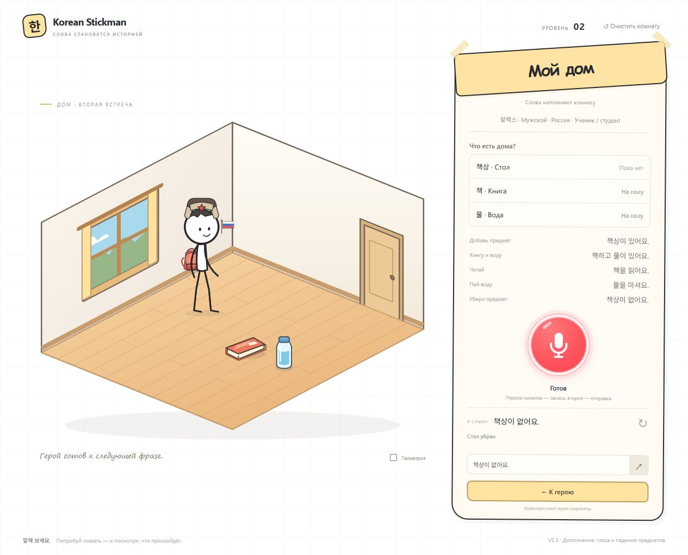

# Дополнение V2.3 — глаза и падение предметов

В профиль и спереди герой показывает два глаза, включая закрытые глаза при моргании. Вид со спины по-прежнему скрывает лицо. Первый уровень не менялся.

Причина перемещения вещей к стене: удаление стола использовало стандартные места создания предметов на полу одновременно для анимации и сохранения. Теперь правило работает через идентификатор опорной поверхности, без привязки к столу: исходные координаты предмета проецируются на пол с нулевой высотой. Анимация начинается в фактической точке предмета, заканчивается под ней и включает небольшой отскок.

При наложении допускается смещение до 36 условных единиц SVG. Уже лежащие на полу вещи остаются на месте. Если рядом нет свободного места, удаление отклоняется с понятным сообщением. Удерживаемый предмет остаётся в руке; меняется только место его будущего возврата. После приземления сохраняются новые координаты, по ним работают подход, взятие и возврат предмета.

## Проверки

- `npm test`: 85/85. Девять новых тестов проверяют начало и конец анимации, отсутствие бокового дрейфа, общую поверхность с произвольным именем и высотой, наложения, сохранения, удержание, навигацию, take/use/put для книги и воды и два глаза в видимых ракурсах.
- В браузере книга переместилась из (528.7, 454.75) в (528.7, 556.75), вода — из (610.7, 483.95) в (610.7, 585.95). В обоих случаях X сохранился, Y увеличился на высоту столешницы 102.
- После перезагрузки координаты совпали. Герой прочитал упавшую книгу и вернул её в ту же точку. Ошибок консоли нет. Использован отдельный тестовый адрес; сохранение на localhost:5173 не сбрасывалось.
- Проверена сборка GitHub Pages. Голос, сервер, ключи и игровая механика первого уровня не менялись. Живой микрофонный прогон не выполнялся. Публикация не выполнялась.

## Как открыть

Используйте существующую папку проекта, `npm run dev` и http://localhost:5173/?level=2. После обновления нажмите Ctrl+F5. Метка в подвале: «V2.3 · Дополнение: глаза и падение предметов».

[До удаления стола](drop-before.png) · [После падения](drop-after.png)

