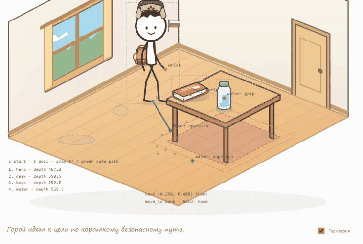

# V2.3 — маршруты, походка и повороты

Переработаны существующие компоненты V2.2. Новая мебель, учебные команды, движок и система STT не добавлялись. Публикация не выполнялась.

## Почему старый путь получался лишним

Диагностика проводилась до изменений на воспроизводимых позициях текущей комнаты. Точных координат проблемного кадра в ТЗ нет; ниже приведены проверенные начальные положения, а не предположение о совпадении с внешним скриншотом.

Основная причина — единственная точка подхода перед столом: для книги всегда выбиралась позиция (0.60, 0.72). Герой обходил мебель к этой точке, даже когда книга была доступна с ближней стороны. Например, из позиции (0.25, 0.40) A* строил безопасный путь длиной 137.7 экранных единиц; достижимая кистью точка слева давала прямой подход примерно за 82 единицы.

Нашлись и дополнительные причины:

- Сетка начиналась с 0.045 с шагом 0.025, но последняя регулярная линия была 0.945 при разрешённой границе 0.965. У правого края оставалась допустимая полоса без узлов; из (0.95, 0.40) старый поиск иногда вообще не находил соединение с сеткой.
- Цена A* считалась в координатах пола, а скорость и длина видимого движения — в экранной проекции. Эти расстояния различаются по направлениям.
- В анимации после каждого сегмента выполнялись отдельное торможение, переступание и поворот. Даже безопасный маршрут выглядел как несколько остановок.
- Порог выбора вида со спины был слишком узким, а прежний «профиль» сохранял два глаза, из-за чего герой часто выглядел смотрящим на зрителя.

Ошибка преобразования координат не обнаружена: обратное преобразование проекции проверяется тестом. Запас вокруг мебели не уменьшался.

## Что исправлено

1. **Выбор подхода.** Для стола и предметов проверяются несколько точек. Отбрасываются места за пределами пола, внутри препятствий, вне физической досягаемости и с неудобным почти полностью сложенным хватом. Из оставшихся выбирается короткий безопасный путь. Уже подходящая текущая позиция сохраняется без лишнего шага.
2. **A*.** Добавлены граничные узлы и несколько безопасных соединений начальной/конечной позиции с сеткой. Цена и эвристика используют ту же проекционную длину, что и анимация. Точки, которые заведомо не улучшат найденный путь, повторно не просчитываются.
3. **Оптимизация.** После A* выбирается короткая цепочка видимых отрезков; равные по длине варианты предпочитают меньше узлов. Углы скругляются только после проверки всех отрезков относительно расширенных препятствий. Если кривая небезопасна, радиус уменьшается либо сохраняется безопасный угол.
4. **Непрерывность.** На весь маршрут используется одна анимация расстояния: плавный старт, равномерная середина и торможение перед концом. Переступание выполняется один раз у цели, не в каждом узле.
5. **Ракурсы.** Направление определяется по касательной траектории, включая диагонали. Небольшая разница порогов переключения защищает от дрожания между видами. Повороты выполняются во время движения; профиль имеет один передний глаз, вид со спины скрывает лицо.
6. **Опора и вложения.** Смена ракурса переводит позу через мировые координаты, сохраняя точки стоп, головы и кисти. Стопы остаются опорными, фаза шага зависит от пройденного расстояния. Флаг рисуется в одном экземпляре; рюкзак плавно меняет точку крепления и порядок перекрытия при переходе к виду со спины.
7. **Начало взаимодействия.** После замедления герой поворачивается к фактическому хвату и принимает устойчивую позу. При подходе сбоку передняя рука и удерживаемый предмет не скрываются столешницей. Владение по-прежнему меняется только в момент контакта кисти.

### Измерения до и после

Комната: стол, книга и вода на столе; команда подхода к книге. Длина дана в условных экранных единицах SVG, до масштабирования браузером.

| Начальная позиция пола | V2.2 | V2.3 | Результат |
|---|---:|---:|---|
| (0.22, 0.72) | 167.9 | 159.5 | Уже прямой путь остаётся прямым |
| (0.25, 0.40) | 137.7 | 81.9 | Прямой подход слева, короче примерно на 41% |
| (0.35, 0.25) | 196.5 | 68.6 | Достижимая боковая точка, короче примерно на 65% |
| (0.95, 0.40) | Путь не найден | 256.4 | Безопасный обход из правой полосы теперь доступен |
| (0.93, 0.15) | 456.0 | 315.1 | Выбран более короткий безопасный подход |

Большой путь справа может оставаться необходимым: прямая к книге пересекает стол. В этом случае герой обходит реальное препятствие, сохраняя прежний запас, а не проходит через него ради короткой линии.

## Геометрия

Обычный режим не показывает технические отметки. При включении «Геометрия» видны:

- S — начало, E — выбранный конец.
- Серый пунктир — исходные узлы A*; зелёный — фактическая оптимизированная безопасная траектория.
- Кандидаты подхода и точки хвата.
- Область мебели и её расширение с учётом размера героя.
- Допустимая область пола, текущие координаты, направление движения и выбранный ракурс.
- Глубина, состояние операции и положение предмета в руке.

После автоматического чтения сохраняется последний непустой маршрут: технический нулевой move_to перед возвратом предмета не затирает полезную диагностику.

## Проверки

`npm test`: **76/76**. Восемь новых тестов дополняют прежние проверки комнаты, первого уровня, сохранений, STT и серверной безопасности.

| Сценарий ТЗ | Проверка |
|---|---|
| A. Лишний подход | Сравнены старый и новый пути из двух левых позиций; новый подход прямой и кисть достигает книги |
| B. Разные точки | Для стола, книги и воды проверен выбор пути из левой, правой, ближней и дальней частей пола; выбранная длина сравнивается со всеми допустимыми кандидатами |
| C. Препятствия | Проверены правая узкая полоса, дополнительное тестовое препятствие, недоступная цель, все отрезки скруглений и границы пола |
| D. Ракурсы | Тестируются четыре стороны и диагонали, устойчивость выбора вида, сохранение мировых точек при повороте; браузерные снимки подтверждают передний и задний вид |
| E. Последовательность | В браузере после чтения из (0.25, 0.40) герой остался в (0.493, 0.540), затем начал путь к воде оттуда и завершил его в (0.760, 0.677) |
| F. Книга и вода | Проверены выбранные подходы, take/use/put с пола и со стола, точный контакт кисти и возврат на исходные поверхности |

Отдельный тест проверяет одну анимацию перемещения на весь составной путь и одно финальное переступание. Проверки мировых точек не допускают скачка головы, стоп и кисти при отражении. Проверяется отсутствие лица и положение рюкзака поверх корпуса сзади; в профиле — один передний глаз.

Браузерные прогоны выполнялись на отдельном локальном адресе с тестовыми начальными позициями. Ваше сохранение на localhost:5173 не сбрасывалось. В записанной последовательности флаг оставался в одном экземпляре на всех кадрах; ошибок консоли нет. Речь проверялась ручными фразами, новый живой микрофонный прогон не выполнялся. Аудиомодуль, паузы, ручное завершение и ключи не менялись.

## Какие файлы изменены

| Файл | Изменение |
|---|---|
| src/room-navigation.js | Границы сетки, проекционная цена A*, оптимизация, безопасные скругления, сравнение подходов |
| src/room-state.js | Несколько точек, досягаемость и выбор удобного подхода; прежнее владение предметами сохранено |
| src/room-motion.js | Преобразование поз между видами, движение по кривой, сохранение опорных точек |
| src/room-space.js | Выбор направления с защитой от частого переключения |
| src/room-renderer.js | Единая анимация маршрута, повороты, слои руки/стола, один флаг и расширенная диагностика |
| src/renderer.js | Слои общего героя, профиль, плавное крепление рюкзака |
| src/main.js, index.html | Метка версии V2.3 |
| tests/room-v23.test.js | Новые проверки A–F |
| tests/room-v22.test.js | Вместо единственной старой точки проверяется корректная досягаемая конечная позиция |

Формат сохранения V2.2 остаётся совместимым. Первый уровень и каталоги не переписывались. Настройки GitHub Pages + Render и публикации прежние; зависимости не добавлены. Тестовый сервер с начальными позициями находится только в рабочей папке агента и не входит в архив проекта или публичную сборку.

## Оставшиеся ограничения

- Это стилизованная 2.5D-походка. Поворот смешивает несколько SVG-ракурсов примерно за 0.2 секунды; на промежуточном кадре возможен мягкий двойной контур. Полноценного вращения скелета и отдельных рисунков каждого аксессуара с любой стороны нет.
- Кривая проверяется как набор коротких отрезков. В тесном углу скругление может быть небольшим или отсутствовать: безопасность важнее плавности линии.
- Сетка и точки подхода дают короткий путь среди проверенных вариантов, не математический глобальный оптимум для любой возможной комнаты. Мебель неподвижна и занимает прямоугольную область.
- Визуальная остановка и движение стоп остаются упрощёнными; физическая модель равновесия и развороты на 360° не добавлялись.

## Материалы

[Короткий подход к книге](v23-short-route.png) · [Движение со спины](v23-back.png) · [Движение к зрителю](v23-front.png) · [Маршрут следующей команды вокруг стола](v23-continuous-route.png)

