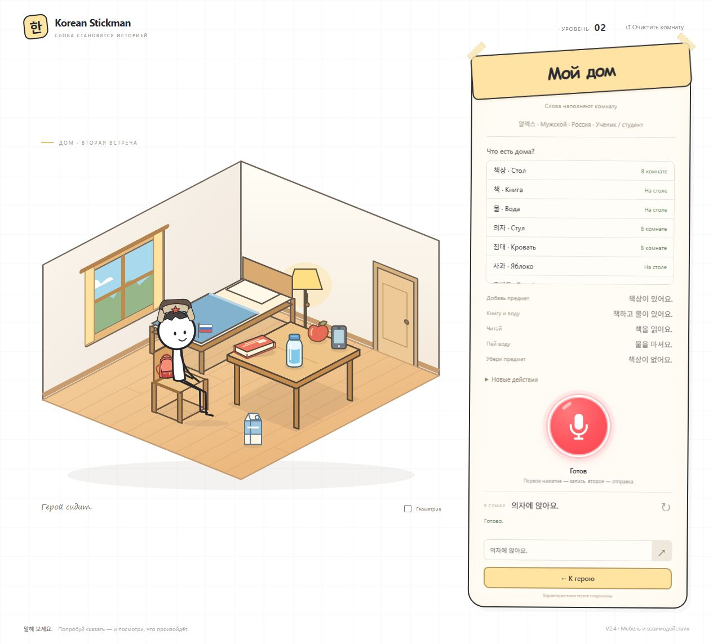
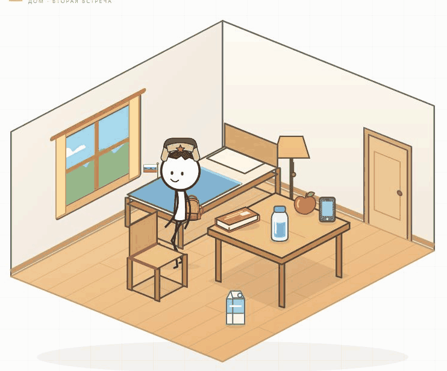
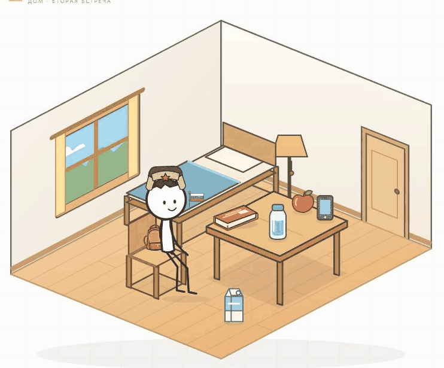
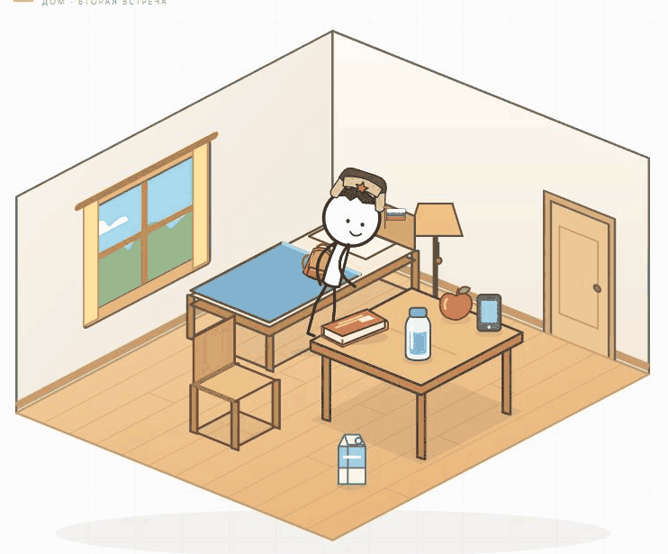
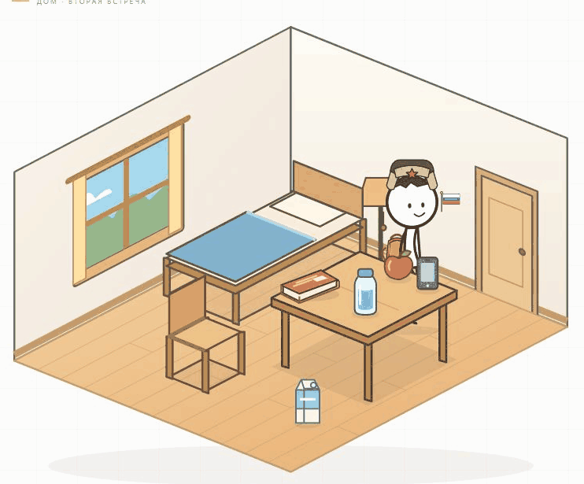

# Korean Stickman V2.4 — мебель и взаимодействия

Добавлены стул, кровать, яблоко, телефон, молоко и лампа. В комнате одновременно помещаются все девять объектов. Публикация не выполнялась.

## Что изменено

- Каталог описывает размер, препятствие, точки взаимодействия, захват и тип использования каждого объекта. Мебель имеет постоянные зоны; лампа расположена вне дверного проёма. Создание поверх героя или напольного предмета отклоняется. Проверяется доступность проходов.
- Мелкие предметы занимают свободные точки на столе, затем на полу. Учитывается видимый размер; место возврата удерживаемой вещи остаётся зарезервированным. Если свободного места нет, появляется сообщение. Уже созданные вещи не переставляются автоматически.
- Удаление поверхности использует общее падение под фактическими координатами с небольшим отскоком. Конечные координаты сохраняются.
- Сидение, лежание и сон используют прежний скелет, аксессуары и плавное смешивание поз. Таз опирается на сиденье, ноги согнуты; лежачая поза идёт по перспективе матраса. Глаза во сне закрыты. Перед движением герой сначала встаёт рядом с мебелью.
- Еда, экран и напитки используют общие move_to/take/use/put. Яблоко уменьшается при укусах и исчезает в конце; телефон подсвечивается и возвращается обратно. Молоко использует прежнее питьё с отдельной поправкой захвата и положения горлышка.
- Лампа переключается при контакте с выключателем. Повторное включение сообщает, что свет уже включён. Лампа, сидение и сон восстанавливаются после перезагрузки.
- Очередь остаётся общей. Занятые руки блокируют сидение, сон и переключатель до начала движения. Отмена восстанавливает последнюю завершённую позу и сохраняет владельца предмета.
- Список девяти объектов прокручивается внутри панели. Новые примеры доступны под «Новые действия». Размер сцены не уменьшен.

## Команды

Для каждого предмета работают `있어요` и `없어요`, например `의자가 있어요`, `침대가 없어요`. Принимаются однозначные варианты без частиц.

| Предмет | Фразы |
|---|---|
| Стул — 의자 | 의자에 앉아요 |
| Кровать — 침대 | 침대에 누워요 · 침대에서 자요 |
| Подъём | 일어나요 — со стула или кровати по текущему состоянию |
| Яблоко — 사과 | 사과를 집어요 · 사과를 먹어요 · 사과를 놓아요 |
| Телефон — 휴대폰 | 휴대폰을 봐요 · 휴대폰을 사용해요 |
| Молоко — 우유 | 우유를 마셔요 |
| Лампа — 전등 | 전등을 켜요 · 전등을 꺼요 |
| Прежние предметы | 책상이 있어요 · 책을 읽어요 · 물을 마셔요 |

В режиме «Геометрия» работают `/move_to phone`, `/take phone`, `/use phone`, `/put phone`, аналогично для apple и milk. Для мебели — `/move_to chair` и `/sit chair`, `/move_to bed` и `/lie_down bed` или `/sleep bed`. `/stand_up chair` и `/stand_up bed` поднимают героя с текущей опоры. `/move_to lamp`, `/toggle lamp` переключают лампу. Пошаговые операции проверяют близость и владение; корейские команды выполняют подход автоматически. `전화하다`, вопросы, отрицания действий и сложные предложения не интерпретируются свободно.

## Проверки

`npm test`: **94/94**. Девять новых сценариев проверяют:

1. Все новые команды, частицы, отрицательные и неоднозначные формулировки.
2. Все девять объектов, раздельные препятствия, свободный подход к двери и безопасный маршрут к каждому объекту.
3. Размещение без наложения, переполнение стола, падение и восстановление координат.
4. Настоящий исполнитель анимаций сидения, вставания, лежания и сна; опору таза, направление лежачей позы и сохранение состояния.
5. Точный контакт кисти, еду с удалением яблока, подсветку телефона, положение горлышка молока и прежние книгу и воду.
6. Сохранение лампы, повторное включение и удаление мебели после вставания.
7. Пошаговый режим, занятые руки и отмену в середине вставания без повреждения сна.
8. Новые переносимые предметы с пола, повторное создание еды и удаление всех новых объектов.
9. Фактические SVG-координаты во время исчезновения стола, начала падения и после сохранения — без преждевременного скачка.

Прежние проверки STT, ручного завершения и пауз, CORS, безопасности секретов, первого уровня, маршрутов и падения остаются успешными. Проверена статическая сборка для `/korean-stickman/`.

В браузере проверены заполненная комната, сидение, сон, сохранение сна после перезагрузки, вставание перед телефоном, телефон, молоко, съедание и повторное создание яблока, свечение и сохранение лампы. Ошибок консоли нет. Использован ручной текстовый ввод на отдельном тестовом адресе; сохранение пользователя на localhost:5173 не сбрасывалось. Новый живой микрофонный прогон не проводился; сервер, аудиомодуль и ключи не менялись.

Схема сохранения комнаты — 3 под прежним ключом `korean-stickman.room.v1`; схемы 1 и 2 читаются. Сохранение героя остаётся прежним. Новых зависимостей и фоновых запросов нет.

## Открыть обновление

В существующей папке проекта выполните `npm run dev`, откройте http://localhost:5173/?level=2 и нажмите Ctrl+F5. Метка: **V2.4 · Мебель и взаимодействия**. Для публикации остаётся прежняя инструкция [GitHub Pages + Render](RENDER.md).

## Снимок и анимации

[Сидение и подход](v24-chair.gif) · [Вставание и сон](v24-bed.gif) · [Телефон](v24-phone.gif) · [Молоко](v24-milk.gif)

