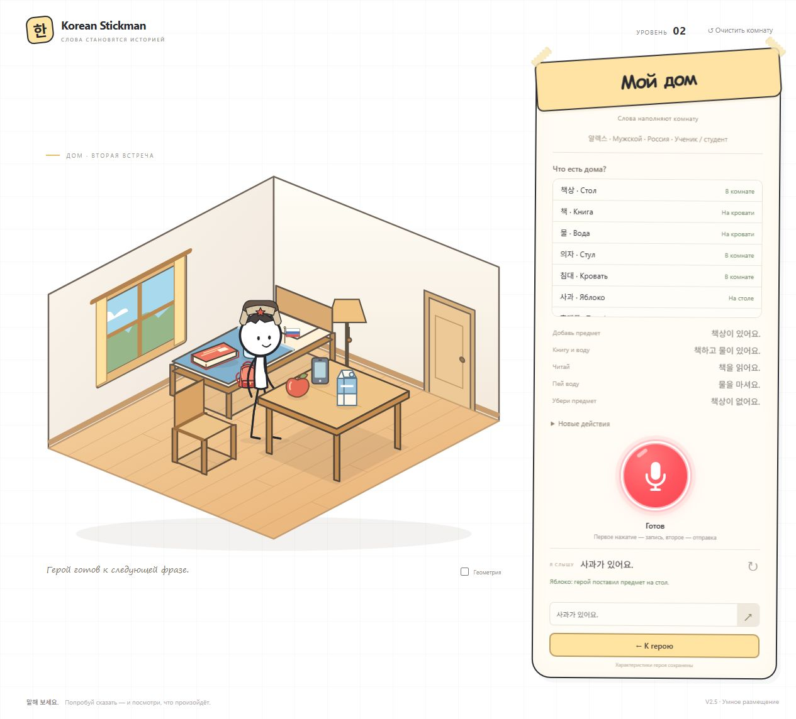

# Korean Stickman V2.5 — умное появление и размещение

Небольшие предметы теперь появляются в руке героя и размещаются через общие операции переноса. Мешающие переносимые вещи больше не запрещают создание мебели, если их можно безопасно убрать. Публикация не выполнялась.

## Как выбирается место

Сначала проверяется, есть ли такой предмет. Повторная команда не меняет позу и не заставляет освобождать руку. Перед новым действием сидящий или спящий герой плавно встаёт. Если рука занята, удерживаемая вещь сначала размещается, затем в руке с коротким эффектом появляется новая.

Для стола и свободной кровати перебираются допустимые точки с учётом размеров предмета, границ, занятого места и возможности дотянуться рукой. До каждой точки подхода рассчитывается безопасный маршрут. Выбирается поверхность с самой короткой достижимой дорогой. Поэтому близкая кровать может оказаться предпочтительнее дальнего стола. Стул и лампа не используются как поверхности.

У стола верхний предел — пять небольших предметов, у кровати — два. Видимые размеры и свободная площадь могут ограничить фактическую вместимость раньше. На кровати используется область матраса без подушки. Место возврата вещи, которую герой держит, считается занятым.

Если поверхности заняты или недоступны, ищется свободная точка пола не дальше 144 условных единиц SVG от текущей позиции героя. По возможности выбираются места вне будущих зон мебели. Проверяются границы пола, препятствия, другие предметы и дистанция от героя. Стандартные напольные места создания больше не используются.

После выбора герой переносит вещь через обычные `move_to` и `put`, оставаясь возле места размещения. Одновременной копии на поверхности и в руке нет. Если безопасного места нет, новая вещь не создаётся; уже удерживаемая остаётся в руке.

## Как освобождается зона мебели

Зоны стола, стула, кровати и лампы остаются фиксированными. Другая мебель и сам герой по-прежнему препятствуют появлению объекта на их месте.

Для переносимых вещей проверяется вся опорная область, а не только центральная точка. До первого движения в копии состояния рассчитывается полный перенос всех мешающих вещей: подойти, взять, найти место за пределами будущего препятствия, перенести и положить. При планировании учитываются уже распределённые места. Герой также должен завершить перенос вне будущей зоны мебели.

Если весь план выполним, действия исполняются последовательно обычными операциями персонажа. Только после освобождения зоны появляется мебель. Если расчёт не находит безопасного решения, настоящая комната не изменяется.

Перенос перед появлением мебели сохраняет снимок исходного состояния. Отмена, ошибка анимации или перезагрузка посреди переноса восстанавливают этот снимок; частично освобождённая комната не остаётся сохранённой. Поздний ответ отменённой анимации не может откатить следующую команду. Отмена до начала первой анимации тоже не запускает отложенное действие.

Для команды сна или лежания применяется тот же перенос: вещи с кровати сначала размещаются в другом месте, затем герой ложится. Если это невозможно, команда отклоняется. В пошаговом режиме лечь на занятую кровать нельзя.

## Падение и сохранение

Удаление стола и кровати сохраняет общее падение под текущими координатами. Места приземления заранее распределяются; допустимо небольшое смещение до 36 единиц SVG для разделения вещей. После приземления дополнительных перемещений нет. Вещи можно снова брать и использовать.

Схема комнаты — 4 под прежним ключом `korean-stickman.room.v1`. Читаются сохранения схем 1–3. Восстанавливаются реальные координаты, поверхность, её высота, владение предметом, поза и лампа. Перезагрузка после появления предмета в руке сохраняет единственного владельца и место, куда его можно положить. Сохранение анкеты героя не менялось.

В режиме «Геометрия» показаны выбранная поверхность, конечная точка, фактический маршрут, занятые области предметов, границы поверхностей, зона новой мебели и мешающие вещи. Старые отладочные напольные слоты убраны.

## Проверки

`npm test`: **107/107**. Тринадцать новых сценариев дополняют прежние проверки комнаты, первого уровня, голосовой записи, пауз и серверной безопасности.

| Сценарий | Результат |
|---|---|
| A. Книга и вода в пустой комнате | Поочерёдно появляются в руке и кладутся рядом, без наложения и изменения позиции героя |
| B. Молоко перед столом | При необходимости переносится из зоны; затем создаётся стол |
| C. Книга при наличии стола | Получение в руку, безопасный подход, точный контакт кисти и размещение на столешнице |
| D. Пять переносимых вещей | Последовательное размещение; проверены все девять объектов и пути к ним |
| E. Недостаток места | Используется другая доступная поверхность или ближний пол; невозможное размещение отклоняется |
| F. Занятая рука | Книга сначала кладётся, затем появляется и размещается яблоко |
| G. Удаление поверхности | Проверены стол и кровать, координаты падения, повторное взятие и использование |
| H. Перезагрузка | Сохраняются координаты и высота кровати; прерванный перенос под мебель откатывается |

Дополнительно проверены все четыре зоны мебели, минимальная длина маршрута между поверхностями, недоступные поверхности, занятая кровать, повторные команды, ошибка и отмена переноса, позднее завершение старой команды и сохранение предмета в руке при прерывании.

В браузере проверены создание книги и воды без мебели, выбор близкой кровати, освобождение зоны от молока перед созданием стола и получение книги для стола, повторное размещение яблока и отладочная отметка выбранной поверхности. Ошибок консоли нет. Проверка проводится на отдельном локальном адресе; сохранение на localhost:5173 не сбрасывается. Новый живой микрофонный прогон через Groq не выполнялся. STT, сервер, ключи, список объектов и голосовые команды не менялись.

Сборка GitHub Pages для `/korean-stickman/` проверена. Дополнительных зависимостей, фоновых запросов и heartbeat нет.

## Оставшиеся ограничения

- Это поиск по набору допустимых точек, а не свободная расстановка мебели или реалистичная физика.
- Пол используется только поблизости. Если в этом радиусе всё занято, предмет не отправляется в дальний конец комнаты: действие отклоняется.
- Мебель не создаётся поверх героя или другой мебели. При необходимости герой должен сначала отойти обычной командой взаимодействия.
- Обычное использование книги, телефона и напитков возвращает их на исходное место. Пошаговые операции сохраняют ручную проверку близости и владения.
- При аварийном откате переноса под мебель возвращается исходное состояние всей этой группы действий, включая позицию героя.

## Как открыть

В существующей папке проекта: `npm run dev`, затем http://localhost:5173/?level=2 и Ctrl+F5. Метка: **V2.5 · Умное размещение**. Схема публикации остаётся прежней: [GitHub Pages + Render](RENDER.md).

## Снимки

[Предметы рядом с героем](v25-nearby.png) · [Выбрана кровать](v25-bed.png) · [Книга на столе](v25-table.png) · [До освобождения зоны](v25-clear-before.png) · [После переноса и создания стола](v25-clear-after.png) · [Все девять объектов](v25-all.png) · [Геометрия размещения](v25-debug.png)

