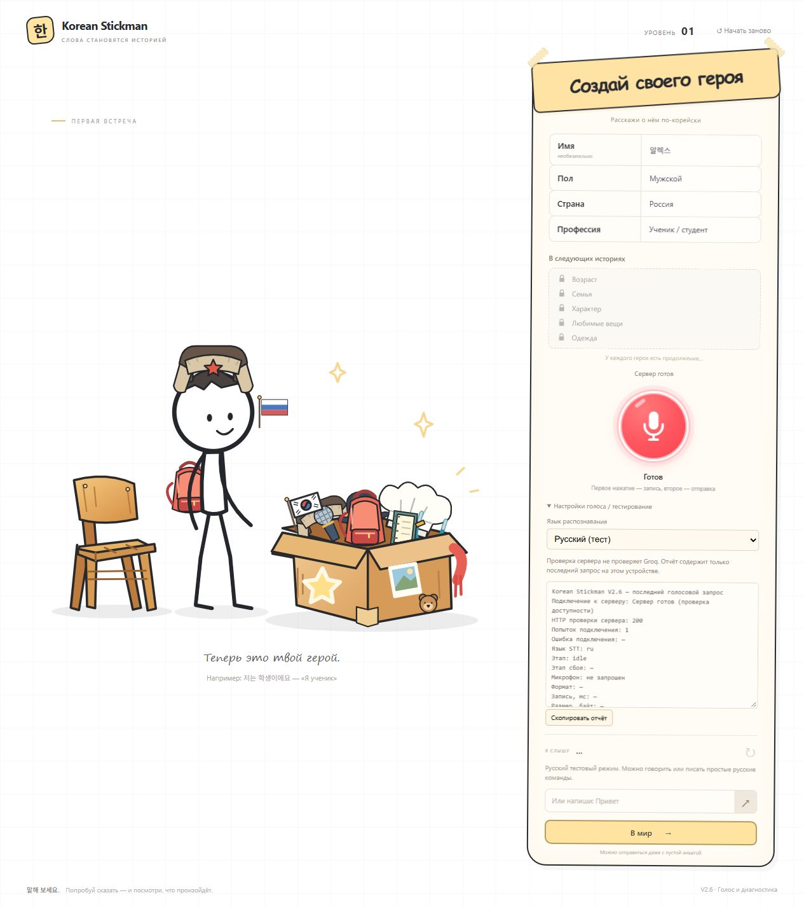

# Korean Stickman V2.6 — голос, русский тестовый режим и диагностика

Реализованы ограниченная проверка готовности сервера, русский тестовый режим и отчёт о последней голосовой попытке. **Локальные автоматические проверки: 120/120. Живой микрофон → Groq и отдельные устройства пока не подтверждены.** Публикация не выполнялась. Причина прежних сбоев на чужих устройствах не установлена: холодный запуск Render остаётся одной из возможных причин.

## Подключение к серверу

Используется существующий безопасный `GET /api/stt/status`. При открытии игры запрос отправляется сразу. Пока идёт ожидание, видны «Подключаем голосовое управление…» и вращающийся индикатор без процента. Микрофон недоступен, текстовое управление работает.

Максимум три попытки: до 20 секунд на каждую, паузы 5 и 10 секунд, общий предел 75 секунд. После готовности или окончательной ошибки проверки прекращаются. Есть явная кнопка «Повторить». Возвращение на вкладку после 10 минут позволяет запустить новую ограниченную проверку; переход между уровнями этого не делает. Постоянного heartbeat нет.

«Сервер готов» подтверждает ответ Render и наличие серверной настройки ключа. Это не проверка правильности ключа и не успешное распознавание Groq. При отсутствии настройки отдельно показано, что распознавание не настроено.

## Запись и восстановление после ошибки

Первое нажатие начинает MediaRecorder, второе завершает запись. Паузы внутри фразы не останавливают запись и не вырезаются. После остановки передаётся весь файл.

В обычном браузере отправка использует XMLHttpRequest, чтобы отдельно увидеть окончание загрузки аудио и ожидание серверного ответа. В тестах и резервном транспорте остаётся fetch. Тайм-аут запроса — 65 секунд, включая получение ответа. Автоматических повторных POST нет.

При сетевой ошибке полная запись остаётся только в памяти устройства. Доступны «Повторить отправку записи» и «Удалить запись». Повторная отправка требует нажатия и использует те же байты и исходный язык. Для новой записи сначала удалите сохранённую. Если сервер перестал быть готов после начала записи, файл не отправляется и не теряется: восстановите подключение и явно повторите отправку. Язык при сохранённой записи заблокирован, чтобы случайно не отправить её с другой настройкой.

После успешного STT файл освобождается; ошибка понимания или игрового действия не вызывает повторного распознавания. При отмене файл удаляется явно. При уходе со страницы с несохранённой записью браузеру запрашивается стандартное предупреждение. После подтверждённого ухода/перезагрузки аудио не сохраняется. Ни аудиофайлы, ни диагностика не записываются в отдельный сервис или localStorage.

Формат выбирается по поддержке браузера: WebM/Opus, Ogg/Opus, MP4. Если конструктор MediaRecorder отвергает выбранный формат, проверяются другие поддержанные варианты. Реальные Safari/iOS этим не считаются проверенными.

## Русский тестовый режим

Под микрофоном откройте **«Настройки голоса / тестирование»** и выберите **«Русский (тест)»**. По умолчанию и после перезагрузки выбран 한국어. Смена языка сохраняет героя и комнату.

Оба языка используют одну цепочку: MediaRecorder → Render `/api/stt` → Groq Whisper → текст → интерпретация → существующие игровые действия. Русский передаётся как `ru` через разрешённый CORS-заголовок; корейский остаётся `ko` по умолчанию. На сервере разрешены только эти два значения. Речь не подменяется локальным распознаванием или Web Speech API.

Для языка сохраняются прежние проверки уверенности Whisper; корейские правила не менялись. Русские фразы сопоставляются с небольшим словарём и вызывают существующие действия. Настройка `language`, многоязычный Whisper и `verbose_json` проверены по [официальной документации Groq](https://console.groq.com/docs/speech-to-text) и [перечню языков официального SDK](https://github.com/groq/groq-typescript/blob/main/src/resources/audio/transcriptions.ts).

| Первый уровень | Второй уровень |
|---|---|
| Привет / Здравствуй | Создай стол / стул / кровать / книгу / воду / яблоко |
| Я мужчина / Я женщина | Прочитай книгу · Выпей воду · Съешь яблоко |
| Я из России / Я из Кореи | Сядь на стул · Встань |
| Я студент / Я учитель / Я врач | Ляг на кровать · Поспи на кровати |
| | Включи лампу · Выключи лампу · Удали стол |

Для создания также принимаются «Поставь…» и «Добавь…». Вопросы, отрицания, неоднозначные и произвольные сложные русские предложения не дополняются до команд. Русский текстовый ввод тоже работает в этом режиме и удобен для проверки действий без микрофона.

## Этапы и диагностика

Отдельно отражаются `requesting_microphone`, `recording`, `audio_ready`, `uploading`, `processing`, `transcribed`, `executing`, `completed`, `error`. Отмена обозначается `cancelled`.

Запрет микрофона, отсутствие устройства, пустая запись, сбой загрузки, недоступный сервер, тайм-аут, ошибка Groq, неразборчивый текст, неизвестная команда и ошибка действия имеют разные сообщения. Клиент сохраняет безопасный код и источник серверной ошибки вместо замены всех ответов 5xx одной общей ошибкой.

В настройках виден текстовый отчёт: готовность сервера и HTTP проверки, выбранный язык последнего запроса, доступ к микрофону в этой попытке, формат, длительность, размер, начало отправки, время ожидания, HTTP ответа, код и этап сбоя, текст, действие и результат. «Отправка начата» не означает, что POST гарантированно дошёл до Render: это видно по ответу и HTTP-статусу.

Кнопка **«Скопировать отчёт»** копирует обычный текст. Если буфер обмена недоступен, текст выделяется для ручного копирования. Отчёт строится по списку разрешённых полей, не включает ключи, cookies, токены, тело аудио или необработанные ответы Groq. Известные форматы ключей дополнительно скрываются.

## Что проверено

120 автоматических тестов, включая 13 новых сценариев. Прежние 107 проверок игры, сохранений, размещения, навигации, записи и пауз остаются успешными.

| Сценарий | Проверка и границы |
|---|---|
| A. Первое открытие после простоя | Ограничения попыток и зависший ответ проверены автоматически; в браузере смоделирован HTTP 503 и показано ожидание. Настоящий холодный старт Render не подтверждён |
| B. Первый голосовой запрос | Автоматически проверены все этапы, транспорт и обработка ответа; живой микрофон и Groq не подтверждены |
| C. Русские команды | Все фразы ТЗ проверены; в браузере «Я врач» меняет героя, «Съешь яблоко» использует прежнюю механику комнаты. Передача `ru` через настоящий локальный HTTP-сервер проверена с тестовым STT-провайдером |
| D. Корейский режим | Прежние тесты проходят; в браузере корейская текстовая команда сработала во время недоступности сервера |
| E. Длинная пауза | Автоматические проверки четырёхсекундной паузы, полного файла и ручного завершения для обоих языков |
| F. Нет сервера | Сеть, тайм-аут и зависшее тело ответа смоделированы; в браузере подтверждены сообщение об ошибке и восстановление через «Повторить» без перезагрузки |
| G. Отказ микрофона | Автоматическая имитация `NotAllowedError`; реальное окно разрешения на устройствах не проверялось |
| H. Повтор после ошибки | Проверены отсутствие автоматического POST, сохранение полного файла, явный повтор тех же байтов и возможность новой записи после удаления |
| I. Перезагрузка | Герой и комната сохранились в браузере; язык вернулся к 한국어, проверка сервера запустилась заново |

Также проверены CORS нового заголовка, отклонение неподдержанного языка, различение Render/Groq, освобождение ограничения одновременных запросов после ошибки, безопасное содержимое отчёта и переход на MP4 при отказе WebM.

Проверки браузера выполняются на отдельном localhost:5178. Сохранение пользователя на localhost:5173 не сбрасывалось. Озвученные тестовые файлы получить из доступного системного синтезатора не удалось: он вернул ошибки и создал только пустые WAV-заголовки. Эти файлы не отправлялись в STT. Реальный успешный русский или корейский ответ Groq в этой версии поэтому не заявляется.

**Не подтверждены:** физический микрофон компьютера, iPhone/Safari, Android/Chrome, первый запрос после настоящего сна Render и полная опубликованная цепочка Pages → Render → Groq. Для завершения полевой проверки нужен запуск после вашего обновления сервиса и речь человека на целевом устройстве.

## Как обновить и проверить

1. Локально остановите прежний сервер и снова выполните `npm run dev`, затем Ctrl+F5. Серверный код изменился; одного обновления страницы недостаточно. Метка: **V2.6 · Голос и диагностика**.
2. При публикации сначала обновите Render, затем GitHub Pages по [существующей инструкции](RENDER.md). На backend нужны новые обработка языка и CORS; старый сервис не обеспечивает русский режим.
3. Build Command Render: `npm ci`; Start Command: `npm start`. Новых переменных нет: сохраните `GROQ_API_KEY`, `FRONTEND_ORIGIN=https://averanges.github.io`, необязательный `STT_MODEL=whisper-large-v3`.
4. На устройстве дождитесь «Сервер готов». В настройках выберите русский и произнесите «Привет», закончив запись вторым нажатием. Затем проверьте команды комнаты. Если возникнет ошибка, скопируйте отчёт.
5. Переключитесь на 한국어, проверьте `안녕하세요`, `책이 있어요`, `책을 읽어요` и паузу 4 секунды. Не отправляйте ключи или записи окружающих людей вместе с отчётом.

Анимации, объекты, навигация, схемы сохранения, ключи и игровая логика не менялись. Новых зависимостей нет.

## Снимки интерфейса

[Ошибка подключения и диагностический отчёт](v26-server-error.png) · [Восстановленное подключение и русский режим](v26-ready-russian.png). В браузере также сработала кнопка копирования отчёта.

