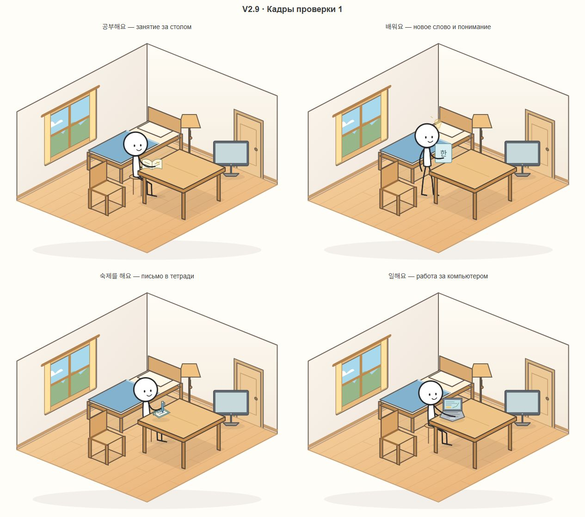
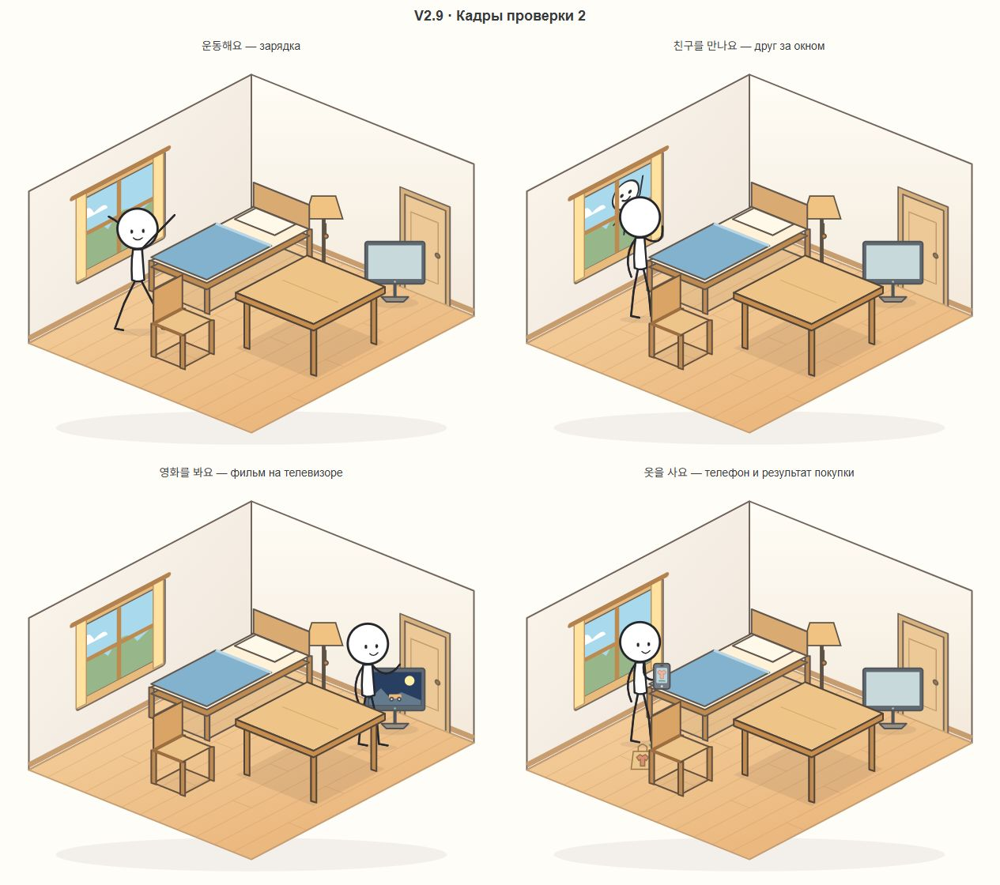

# Korean Stickman V2.9 — учебные действия дома

Готова локальная версия V2.9. Публикация не выполнялась. Второй уровень расширен в существующей комнате; голосовая система V2.8, первый уровень, внешность героя, его аксессуары и сохранения сохранены.

## Все 12 глаголов

| Глагол | Команда | Что нужно | Реакция |
|---|---|---|---|
| 자다 | `침대에서 자요`, `자요` | Кровать | Прежняя анимация сна |
| 먹다 | `사과를 먹어요` | Яблоко | Прежняя анимация еды |
| 읽다 | `책을 읽어요` | Книга | Прежнее чтение книги в руках |
| 마시다 | `물을 마셔요`, `우유를 마셔요` | Вода или молоко | Прежняя анимация питья |
| 공부하다 | `공부해요`, `공부를 해요` | Стол, свободный участок столешницы | Герой садится на временный табурет и занимается с раскрытым учебным материалом на столе |
| 배우다 | `배워요`, `한국어를 배워요` | Стол, свободный участок столешницы | Стоя у стола, смотрит на карточку «한»; появляется лампочка понимания |
| 일하다 | `일해요` | Стол, компьютер | При необходимости переносит компьютер на стол, садится и печатает; на экране окна и график |
| 운동하다 | `운동해요` | Свободное место | Подходит в доступную зону и выполняет цикл прыжков с разведением рук и ног |
| 친구를 만나다 | `친구를 만나요` | Окно уже есть в комнате | Друг выглядывает и машет за рамой; герой подходит и машет в ответ; друг скрывается |
| 옷을 사다 | `옷을 사요` | Телефон | Берёт телефон, на экране появляется одежда, рядом — пакет с футболкой; телефон возвращается на прежнее место |
| 영화를 보다 | `영화를 봐요` | Телевизор | Подходит к экрану и смотрит короткую сцену с движущейся машиной |
| 숙제하다 | `숙제를 해요`, `숙제해요` | Стол, тетрадь и ручка | Тетрадь переносится на стол, ручка берётся в руку; герой садится и пишет, на странице появляются строки |

После новых коротких сцен герой возвращается в нейтральную стоячую позу. Для изучения и учёбы используется временный сценический реквизит — карточка/материал и табурет, без новых постоянных предметов. Он не записывается в сохранение. Пакет покупки — визуальный результат, без магазина, денег, инвентаря одежды или новой карты; исчезает при синхронизации/смене сцены и не создаёт препятствий.

## Четыре новых предмета

Создание и удаление используют ту же систему, что остальные вещи:

- `공책이 있어요` / `공책이 없어요` — тетрадь.
- `펜이 있어요` / `펜이 없어요` — ручка.
- `컴퓨터가 있어요` / `컴퓨터가 없어요` — компьютер, изображён как ноутбук.
- `텔레비전이 있어요` / `텔레비전이 없어요` — телевизор.

Тетрадь, ручка и компьютер — переносимые предметы: появляются через получение в руку и размещение на доступной поверхности/полу. Телевизор — мебель с собственной зоной у задней стены. Размещение учитывает опоры, занятость, габариты и маршруты. При удалении стола новые предметы падают под своими текущими позициями, как прежние. Их координаты и принадлежность сохраняются.

Старые сохранения поддержаны без смены ключей или формата мира. Отсутствующие в старом сохранении новые предметы считаются ещё не созданными. Профиль первого уровня не сбрасывается.

## Отсутствие предметов и свободного места

Новые действия не создают постоянные вещи автоматически. Например, без тетради/ручки домашнее задание сообщает `공책하고 펜이 필요해요` с русским пояснением. Отказ не подменяется общим сообщением при голосовом исполнении: причина игрового отказа остаётся видна.

Если рука занята, перед сценой предмет безопасно кладётся по существующим правилам. Для домашнего задания и работы реальные тетрадь/компьютер доставляются на стол через обычные операции подхода, взятия и размещения. Ручка и телефон после использования возвращаются на свои опоры.

Если стол переполнен, сначала уберите лишние вещи. Сообщение указывает, для какого предмета не хватает места. Игра не очищает стол или комнату самовольно. В заполненной комнате возможность действия зависит от наличия доступного участка; невозможный маршрут или нехватка места дают понятный отказ.

## Голосовой и текстовый ввод

Новые корейские команды добавлены в прежний интерпретатор второго уровня как небольшой список точных формулировок. Большого NLP-слоя, новых грамматических режимов и оценки произношения нет. Вопросы, отрицания и неоднозначные составные утверждения по-прежнему не угадываются.

В русском тестовом режиме добавлены простые соответствия: «учись», «изучай корейский», «сделай домашнее задание», «работай», «сделай зарядку», «встреть друга», «посмотри фильм», «купи одежду». Для предметов: «создай тетрадь/ручку/компьютер/телевизор» и «удали …».

Ручное завершение аудио, сохранение записи при сетевом сбое, автоматические резервы STT и диагностика V2.8 не менялись. Все новые транскрипции поступают в ту же очередь игровых действий, что текст. Отмена сцены очищает временные эффекты; уже завершённые переносы предметов сохраняют корректную принадлежность. Старый ответ не продолжает действие после отмены или смены уровня.

## Проверки

Финальный прогон: **159 автоматических тестов, все прошли** (`node --test --test-concurrency=2 tests/*.test.js`). Включены прежние тесты голоса, первого уровня, сна, чтения, питья, еды, лампы, телефона, мебели, навигации и размещения.

Новые проверки:

- Все новые фразы, их базовые варианты, создание и удаление четырёх объектов; отказ для вопросов и отрицаний.
- Все восемь новых сцен через настоящие RoomController и RoomRenderer с ускоренным тестовым временем.
- Тетрадь/компьютер на настоящем столе; ручка в руке, движение кисти по координатам тетради; возврат ручки и телефона.
- Реакция на отсутствие реквизита без сброса героя или вещей.
- Одновременное существование всех 13 предметов, доступность подходов и безопасные маршруты, свободный подход к двери.
- Падение новых предметов при удалении стола и восстановление координат после загрузки.
- Отмена во время домашнего задания: временная сцена очищается, предметы не дублируются и не исчезают.
- Восстановление сохранений, созданных до V2.9.
- Все восемь новых транскрипций через BrowserSpeech: ручной старт/стоп, отсутствие отправки до стопа и ровно одно исполнение через игровую очередь. Микрофон и STT в этом тесте подставные.

В браузере отдельно проверены восемь визуальных сцен. Для этого использовалась изолированная копия в work: заранее подготовленные сохранения и ускоренные переходы, сами позы, SVG и действия — из кода игры. Снимки ниже — сохранённые промежуточные кадры этого прогона. Копия и вспомогательные сценарии в поставку не входят.

Дополнительно открыта финальная версия без тестовых модификаций на отдельном локальном порту. Загружен прежний профиль героя с характеристиками и прежняя комната; проверена команда `운동해요` с обычной скоростью анимации и возврат к готовности, без ошибок страницы. Рабочий процесс пользователя на порту 5173 не останавливался.

Реальная диктовка новых фраз через микрофон/Groq и проверка на настоящем телефоне в этой итерации не выполнялись. Результаты реальных проверок трёх STT-серверов предыдущей версии приведены в [V2.8](V2.8.md); они не выдаются за новые голосовые проверки V2.9.

## Файлы и запуск

Новые модули: `src/room-lessons.js` — условия и последовательности сцен; `src/room-lesson-art.js` — позы, сценический реквизит и анимация.

Расширены `room-catalog.js`, `room-state.js`, `room-art.js`, `room-furniture.js`, `room-renderer.js`, русский тестовый словарь, список предметов и подсказки в `index.html`. Обновлены версия, README, справка HOME, отчёт и тесты. В `main.js` сохранена конкретная причина отказа игрового действия после голоса; архитектура STT не менялась.

Локально: в папке игры `npm ci`, затем `npm run dev`, открыть http://localhost:5173/ и обновить страницу. В подвале — **V2.9 · Действия дома**. Для публикации достаточно обновить frontend через существующий workflow GitHub Pages. Сборка — `npm run build:pages` с прежним `API_BASE_URL`. Серверные переменные и ключ Groq менять не требуется.

Проверены сборка Pages и состав ZIP: новые JS и встроенные SVG включены, `.env`, секреты и временные файлы исключены. Самостоятельная публикация, push и изменение облачных настроек не выполнялись.
