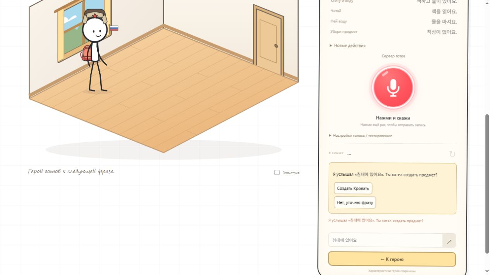

# Korean Stickman V3.0 — понимание команд

Подготовлена локальная версия 3.0.0. Публикация и обновление облачных серверов не выполнялись. Игровые предметы, навигация, анимации и формат сохранений не менялись. Запись MediaRecorder, ручное завершение, индикатор громкости и переключение STT-серверов сохранены.

## Как устроено

```text
MediaRecorder → полная запись → существующий STT API → Groq Whisper
                                                       ↓ исходный текст
Ручной текст ───────────────────────────────→ нормализация без подмены смысла
                                                       ↓
                                             быстрый локальный разбор
                                                       ↓ если не уверен
                                      /interpret → сервер → Groq LLM
                                                       ↓
                              ограниченная схема намерения + проверка слов
                                                       ↓
                                  проверка предметов и состояния комнаты
                                                       ↓
                                      существующий игровой движок
```

Исходная транскрипция, локальный разбор и итоговое намерение хранятся раздельно. Ни модель, ни распознавание не получают прямого доступа к состоянию игры. LLM не генерирует код или новые действия. Неоднозначность может завершиться уточнением или отказом выполнить команду.

Языковой слой выделен в `src/language-catalog.js`, `language-contract.js`, `language-local.js`, `language-service.js`, `language-journal.js`. Серверный провайдер — `server/interpret.mjs`, обработчик — `server/language-api.mjs`. Обе точки `/interpret` и `/api/interpret` доступны через общий сервер; добавлен вход `api/interpret.js` для Vercel и маршруты Netlify. STT остаётся прежним.

## Что понимается локально

- Настоящее время `아/어요`, знакомые формальные формы, `(으)세요`, `아/어 주세요`.
- Словарные формы знакомых действий в свободной практике: `물 마시다`, `공부하다`, `운동하다`.
- Пропуск частиц при однозначном смысле: `책 읽어요`, `물 마셔요`, `의자 앉아요`, `침대 있어요`.
- Несколько характеристик героя: `저는 러시아 학생이에요` → Россия и студент; `저는 한국 사람이고 선생님이에요` → Корея и преподаватель.
- Если известна только часть характеристик, сохраняется эта часть. Неизвестная профессия не превращается в ближайшую известную.
- Существующие действия V2.9, включая учёбу, домашнее задание, работу, зарядку, встречу, фильм и покупку.
- Отрицания, запреты, вопросы и прошедшее время распознаются как основание не запускать положительное действие. Существующее `책상이 없어요` по-прежнему убирает стол.

Это ограниченный разбор знакомых конструкций, а не полный морфологический анализ корейского языка. Внутренние признаки времени и типа высказывания служат для безопасности действий, не для оценки ученика.

Примеры:

| Фраза | Результат |
|---|---|
| `물을 마시세요` | Пить воду, если вода существует |
| `물 좀 마셔 주세요` | То же, локально |
| `의자 앉아요` | Сесть на существующий стул; осторожная учебная подсказка доступна в диагностике |
| `저는 러시아 학생이에요` | Установить две характеристики |
| `저는 캐나다 사람이고 학생이에요` | Сохранить известную профессию, не выдумывать страну |
| `물을 마시지 마세요` | Ничего не пить |
| `물을 마셨어요` | Не выполнять новое питьё |
| `물을 마셔도 돼요?` | Не выполнять вопрос как команду |
| `책을 읽고 물을 마셔요` | Показать составное намерение; предложить команды по одной |
| `침대에 가서 자세요` | Не сокращать два действия до одного |

## Когда игра уточняет

`침대에 있어요` сохраняет значение возможного описания местоположения. Если кровати нет, появляется вопрос с отдельной кнопкой «Создать Кровать». Только подтверждение запускает создание. Если кровать уже существует, автоматического создания или перемещения нет.

`마셔요` использует очевидный объект: подходящий предмет в руке либо единственный доступный напиток. При наличии и воды, и молока предлагается выбор. Отмена уточнения ничего не меняет. Перед подтверждением заново проверяется состояние комнаты.

Если герой уже стоит, `일어나요` не запускает анимацию вставания. Если отсутствует нужный предмет, игра сообщает об этом. Противоречивые характеристики и неизвестный субъект не присваиваются герою автоматически.

## Резервная LLM

Обычные команды не требуют сети для интерпретации. Только неуверенный локальный разбор может вызвать один серверный запрос. Известные опасные или неполные конструкции не направляются модели для «дописывания». Модель получает текущую фразу, небольшой контекст комнаты и каталог возможностей; имя героя и история игры в контекст не включаются.

Реальные проверки Groq после корректировки:

| Фраза | Локально | LLM | Проверка | Время полного HTTP-запроса |
|---|---|---|---|---|
| `거기 보이는 물을 한 모금 마셔 주세요` | Не определено | `drink / water` | Разрешено | 2869 мс |
| `책상 위에 놓인 책을 잠깐 읽어 주세요` | Не определено | `read / book` | Разрешено | 1184 мс |

Это реальные ответы API с проверкой намерения; автоматическое выполнение этих двух запросов в браузере не имитировалось. Фраза `저의 국적은 러시아이며 직업은 학생입니다` обработана серверным локальным разбором: Россия + студент, без LLM, около 8 мс вместе с HTTP.

Настройки только на сервере:

| Переменная | Значение |
|---|---|
| `GROQ_API_KEY` | Существующий секретный ключ, используется Whisper и по умолчанию LLM |
| `LLM_MODEL` | `openai/gpt-oss-20b` по умолчанию; можно заменить совместимой моделью Groq |
| `LLM_ENABLED` | `true` по умолчанию; `false` отключает резервный разбор |
| `LLM_API_KEY` | Необязательный отдельный ключ Groq для LLM |

Серверный тайм-аут интерпретации — 8 секунд, клиентский — 10 секунд. Внутри одного процесса допускаются 1 одновременный LLM-запрос и 12 обращений к модели в минуту; JSON-запрос ограничен 16 КиБ, фраза — 500 символами. Эти ограничения отделены от STT. На серверных функциях лимиты относятся к отдельному экземпляру и не являются общим лимитом расходов аккаунта. Новая система распределённых квот не добавлялась.

Ответ модели проверяется по точной схеме, каталогу действий, признакам исходной фразы и существующим объектам. Неизвестные поля, объекты и действия отклоняются. JSON mode помогает получить JSON, но сам по себе не гарантирует смысл или схему: проверка выполнена приложением. См. [документацию Groq](https://console.groq.com/docs/structured-outputs) и [список моделей](https://console.groq.com/docs/models).

Ошибки, тайм-аут или старый сервер без `/interpret` не отключают локальные команды. Повторные LLM-запросы, heartbeat и отдельный failover для модели не добавлялись. Смена уровня, сброс, новая запись или новая фраза отменяют ожидание прежней интерпретации; запоздалый ответ не исполняется.

## Диагностика

В настройках голосового ввода есть раздел «Языковой слой». Полный копируемый отчёт содержит исходный и нормализованный текст, локальный результат, грамматические признаки, итоговое намерение, факт HTTP-запроса и вызова модели, основание принятия, проверку мира, игровой результат и отдельные времена STT, локального разбора, модели, проверки и исполнения.

История ограничена 50 командами текущей сессии и исчезает после перезагрузки. Она не записывается в localStorage и не отправляется модели целиком. Копируемый отчёт скрывает распространённые форматы ключей и токенов; он всё равно содержит произнесённые фразы, поэтому его следует просматривать перед передачей другим людям. Русский тестовый режим и отладочные slash-команды сохранены на прежнем пути; отдельный языковой журнал V3.0 относится к корейскому вводу.

Учебные подсказки отделены от исполнения и доступны в диагностике. Формулировки не объявляют ошибку STT подтверждённой ошибкой ученика. Баллы и оценка произношения не добавлялись. Конфигурация контекста допускает будущий грамматический режим, но полноценной проверки целевой грамматики пока нет.

## Сравнительные проверки

Независимые ожидаемые результаты находятся в `tests/language-corpus.json`: 115 фраз по категориям A–I. Для положительных случаев зафиксированы действие, объект либо характеристики; остальные требуют отсутствия исполнения. Набор содержит 68 разрешённых и 47 неисполняемых случаев; проверяются схема и допуск к исполнению. Набор проверяется отдельно от HTTP-модели. Сравнение можно повторить командой `npm run benchmark:language` (время зависит от компьютера). В сравнении использованы прежние `interpretSpeech` / `parseRoom`, а не переписанная имитация прежнего поведения.

| Показатель | Прежняя система | V3.0 |
|---|---:|---:|
| Ожидаемый результат, включая безопасный отказ | 83 / 115 | 115 / 115 |
| Ошибочные положительные действия | 0 | 0 |
| LLM-вызовы в этом наборе | 0 | 0 |

Улучшение — дополнительные понятные формы и контекст, а не улучшение самого Whisper. Набор составлен под заявленные конструкции; это регрессия, а не статистическая оценка любой речи.

На этом компьютере, после прогрева, 2300 локальных разборов: среднее 0.20 мс, медиана 0.05 мс, 95-й процентиль 0.53 мс. Это время разбора без сети и анимации. Два финальных реальных LLM-запроса заняли 1,18–2,87 секунды, в среднем 2,03 секунды. Выборка слишком мала для обещания производительности облака.

За всю работу выполнены 4 реальных вызова языковой модели: два первоначальных и два после уточнения инструкций. Третий текст в каждом прогоне разбирался локально. Автоматические HTTP-тесты используют подставной провайдер и в эти 4 вызова не входят.

Полная автоматическая проверка: 288 тестов, включая прежние сценарии игры, ручную запись, паузы, отмену, STT failover, маршруты Render/Netlify/Vercel, CORS, изоляцию лимитов и тайм-ауты модели. Команда:

```sh
node --test --test-concurrency=2 tests/*.test.js
```

## Настоящее аудио

Записи участников занятия не предоставлены. Вместо них сделана ограниченная техническая проверка на трёх открыто лицензированных человеческих записях. Это не подмена пользовательского тестирования. Аудиофайлы не включены в архив проекта.

| Произнесено по источнику | Whisper | Локальный результат | LLM | Итог |
|---|---|---|---|---|
| `안녕하세요` | `안녕하세요` | Приветствие | Нет | Команда разрешена; анимация в этом аудиотесте не запускалась |
| `물을 마시다` | `물을 마시다` | Пить воду, словарная форма | Нет | Существующий RoomController завершил питьё с тестовым исполнителем анимации; раньше фраза отклонялась |
| `침대` | `침대` | Неполная фраза | Нет | Ничего не создано |

Whisper занял 530, 343 и 336 мс соответственно. Аудио проходило через существующий `GroqWhisper` с прежними порогами качества. Для проверки движка использована отдельная тестовая комната; пользовательское сохранение не изменялось.

Источники: [안녕하세요 — HappyMidnight, CC BY-SA 4.0](https://commons.wikimedia.org/wiki/File:안녕하세요.ogg), [물을 마시다 — HappyMidnight, CC BY-SA 4.0](https://commons.wikimedia.org/wiki/File:물을_마시다.ogg), [침대 — CHK2605, CC0](https://commons.wikimedia.org/wiki/File:LL-Q9176_(kor)-CHK2605-침대.wav).

Важный случай «произнесено `침대 있어요`, Whisper добавил `에`» проверен текстом и в интерфейсе, но не реальной записью полной фразы. Подтверждать улучшение такого распознавания пока нельзя. Следующий ручной тест — запись ученика с его согласием: сравнить произнесённое, сырой STT и предложенное уточнение.

## Проверка интерфейса

В отдельной локальной копии проверены две характеристики из одной фразы и их сохранение после обновления, переход в комнату, уточнение `침대에 있어요`, создание кровати только после нажатия подтверждения, вежливая команда сна и отрицание. Исходный localhost:5173 для этих проверок не сбрасывался. Клавиша микрофона и существующая запись не переписывались.



## Как обновить публикацию

1. Обновить исходники репозитория этой версией, не копируя `.env`, локальные ключи или `node_modules`. `.gitignore` сохранён. При обновлении существующей локальной папки сохранить свой `.env` отдельно: в архив он не входит.
2. На Render, Netlify и Vercel обновить backend из того же репозитория. Существующие настройки STT и Origin оставить. Для Pages разрешён конкретный источник `https://averanges.github.io` — без `/korean-stickman/`.
3. Проверить на каждом backend `/health`: HTTP 200, `ok:true`, `version:"3.0.0"`, `capabilities.interpretation.version:1` и `enabled:true`, если ключ задан и LLM не выключена.
4. Render: Node.js 24.x, Build Command `npm ci`, Start Command `npm start`; существующие PORT/публичный адрес и API-only режим сохранены. Добавить необязательные LLM-настройки из таблицы выше при необходимости.
5. Netlify: использовать существующий `netlify.toml` из обновлённой версии. Функция `netlify/functions/stt.mjs` теперь также обрабатывает `/interpret` и `/api/interpret`; wrapper не передаёт runtime Context как pathname.
6. Vercel: обновить `api/interpret.js` и `vercel.json` вместе с общими модулями сервера. Существующие рабочие переменные публичного адреса не менять; hostname штатных переменных Vercel обрабатывается прежним способом.
7. GitHub Pages: оставить существующий GitHub Actions workflow; он собирает только публичные файлы. Страница остаётся `https://averanges.github.io/korean-stickman/`, адреса серверов прежние. Изменения каталога `src` автоматически попадут в сборку с относительными путями.
8. Обновить страницу и проверить одну простую фразу, одну сложную просьбу и уточнение про кровать. До обновления backend простые команды уже работают; модель будет отмечаться как недоступная/не настроенная без поломки игры.

Локально: Node.js 24.x, `npm ci`, `npm run dev`, затем `http://localhost:5173`. После замены серверных файлов перезапустить свой локальный сервер. Одного обновления страницы достаточно только для клиентских файлов.

## Известные ограничения

- Полного анализа произвольной корейской речи нет; неизвестные слова безопасно отклоняются.
- Составные действия, кроме прежнего создания книги и воды, не исполняются цепочкой.
- Модель может ошибаться или быть недоступной. Схема и проверки ограничивают ответ, но не дают абсолютной гарантии понимания любой фразы.
- Глобального распределённого лимита для serverless-экземпляров нет; расходы также зависят от настроек аккаунта Groq.
- Публичные новые маршруты проверены локальными адаптерами и настоящими запросами Groq, но не проверены после облачного деплоя: публикация не выполнялась.
- Строгая грамматическая практика, баллы, оценка произношения и автоматическая повторная отправка аудио не реализованы.
